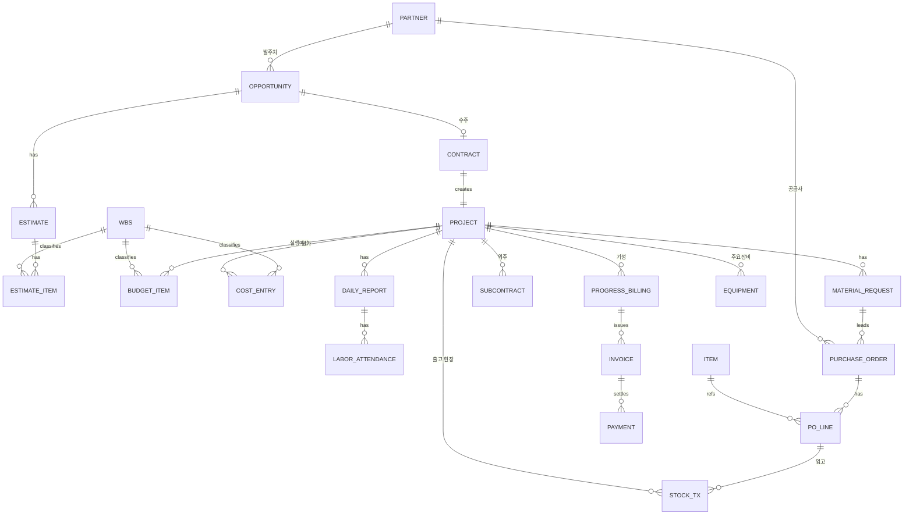
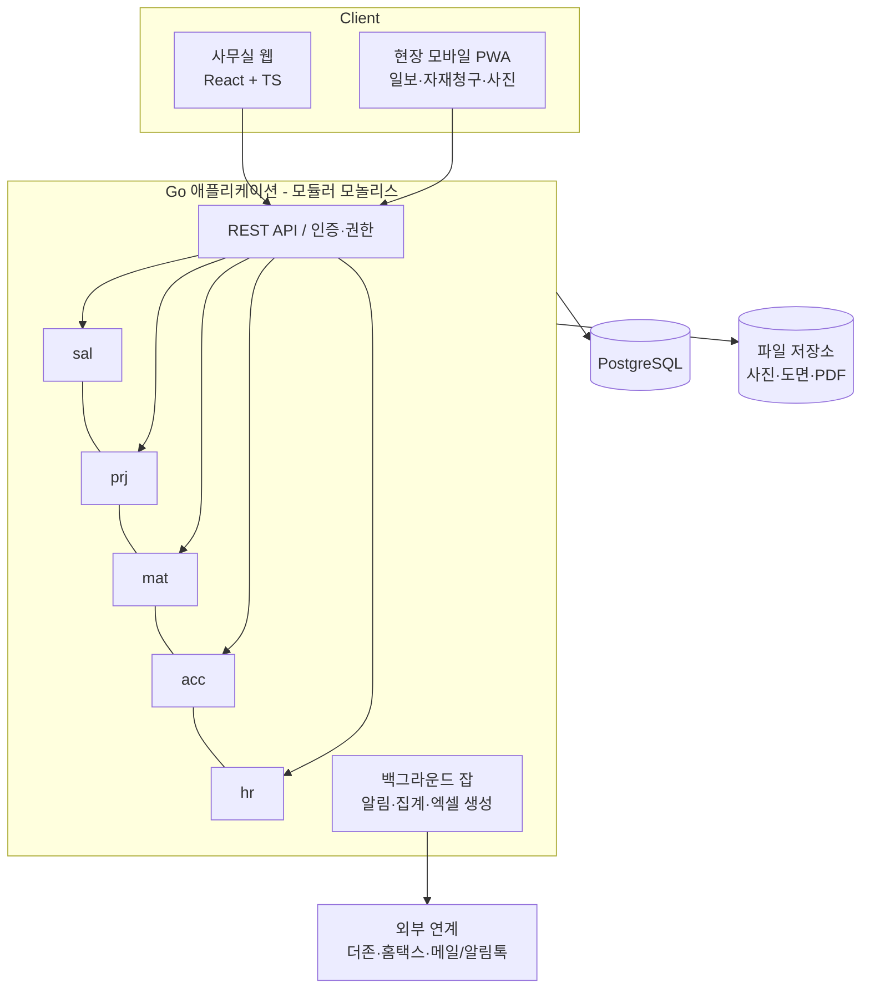

# KD기공 ERP 기획·설계서 (v0.1 초안)

작성일: 2026-11-09
대상: 건축물 기계설비·공조 시공 전문업체 (중규모, 20~100명, 다수 현장 동시 진행)
기술 방향: Go 백엔드 + PostgreSQL + 웹 프론트엔드(React/TypeScript), 현장용 모바일 웹(PWA)

---

## 1. 목표와 원칙

이 ERP의 핵심 목표는 **"현장 하나하나가 돈을 벌고 있는지 실시간으로 보이게 하는 것"**입니다. 기계설비 업체는 수주 금액 대비 실행예산을 세우고, 공사 중 자재·노무·외주비가 예산을 넘지 않는지, 기성은 제때 청구·수금되는지가 손익을 좌우합니다. 따라서 모든 거래(발주, 출고, 노무 투입, 외주 계약, 경비)는 반드시 **현장 + 공종 + 원가요소**로 태깅되어 쌓이도록 설계합니다.

설계 원칙은 다음과 같습니다. 첫째, 데이터는 한 번만 입력합니다(견적 내역 → 실행예산 → 발주 → 원가로 이어짐). 둘째, 현장 소장은 휴대폰으로 일보·자재 요청·사진 업로드를 3분 안에 끝낼 수 있어야 합니다. 셋째, 회계는 처음부터 완전한 복식부기를 직접 만들기보다, 원가·매입매출을 정확히 쌓고 기존 회계 프로그램(더존 등)과 연계하는 방식으로 시작합니다. 넷째, 1차 오픈 범위를 작게 잡고 단계적으로 확장합니다.

---

## 2. 전체 업무 흐름

```mermaid
flowchart LR
    A[영업기회/입찰공고] --> B[견적 산출<br/>내역서·일위대가]
    B --> C{수주?}
    C -- 실주 --> Z[실주 분석]
    C -- 수주 --> D[계약 등록<br/>보증서·선급금]
    D --> E[실행예산 편성<br/>공종×원가요소]
    E --> F[공사 진행]
    F --> F1[자재 요청→발주→입고→현장출고]
    F --> F2[노무 투입<br/>작업일보·출역]
    F --> F3[외주(하도급) 계약·기성]
    F --> F4[현장 경비]
    F1 & F2 & F3 & F4 --> G[현장 원가 집계]
    F --> H[기성 청구<br/>공정률·내역 기준]
    H --> I[세금계산서·수금]
    G & I --> J[현장 손익<br/>예산 vs 실적]
    F --> K[시운전·TAB·준공]
    K --> L[하자보수 기간 관리]
```

---

## 3. 모듈 구성

총 8개 모듈로 나눕니다. 1~4가 업무의 몸통이고 5~8은 공통 기반입니다.

| # | 모듈 | 주요 사용자 | 핵심 질문 |
|---|------|------------|----------|
| 1 | 영업·견적·수주 (SAL) | 영업/견적 담당, 대표 | 어떤 공사를 얼마에 따낼 것인가 |
| 2 | 현장(공사) 관리 (PRJ) | 공무, 현장소장 | 현장이 계획대로 가고 있는가 |
| 3 | 자재·구매·재고 (MAT) | 구매 담당, 창고, 현장 | 필요한 자재가 제때·적정가에 들어오는가 |
| 4 | 원가·회계 (ACC) | 경리/재무, 대표 | 현장별로 남는가, 돈은 들어오는가 |
| 5 | 인사·노무 (HR) | 총무/인사, 현장 | 사람(직원·일용직) 투입과 급여·공제 |
| 6 | 거래처·기준정보 (MDM) | 전 부서 | 발주처, 협력사, 품목, 공종 코드 |
| 7 | 전자결재·문서 (WF) | 전 직원 | 누가 승인했는가 |
| 8 | 대시보드·리포트 (RPT) | 경영진 | 회사 전체 현황 한눈에 |

### 3.1 영업·견적·수주 (SAL)

| 기능 | 설명 |
|------|------|
| 영업기회 관리 | 발주처(원도급 건설사/건축주), 공사명, 예정금액, 입찰일, 진행단계(정보→견적→입찰→결과) |
| 견적(내역서) 작성 | 공종 트리(위생/급수급탕/난방/소화/공조배관/덕트/자동제어 등) 아래 품목별 수량×단가(재료비·노무비·경비) |
| 일위대가·단가 DB | 표준품셈 기반 일위대가, 자사 실적 단가, 최근 매입단가 참조 |
| 엑셀 가져오기/내보내기 | 발주처 양식 내역서 업로드 → 자동 매핑, 제출용 엑셀 출력 (현실적으로 가장 중요한 기능) |
| 견적 버전 관리 | 1차/2차/네고 버전, 버전 간 증감 비교 |
| 수주/계약 | 계약금액, 계약일, 공사기간, 선급금, 지체상금률, 기성 조건, 하자보수기간·보증률 |
| 보증서 관리 | 계약·선급금·하자보수 보증증권 (기계설비건설공제조합 등) 발급·만료 알림 |
| 설계변경(변경계약) | 증감 내역서, 변경 계약금액 이력 |

### 3.2 현장(공사) 관리 (PRJ)

| 기능 | 설명 |
|------|------|
| 현장 마스터 | 현장코드, 주소, 원도급사, 현장소장·공무 담당, 공사기간, 상태 |
| 실행예산 | 수주 내역을 기반으로 공종×원가요소(재료/노무/외주/경비) 실행금액 편성, 승인 후 확정, 변경 이력 |
| 공정 관리 | 공종별 계획 공정률 vs 실적 공정률 (간단한 S-curve), 마일스톤(배관 완료, 장비 반입, 시운전, TAB, 준공) |
| 작업일보 (모바일) | 날씨, 작업 내용(공종별), 출역 인원(직영/외주), 장비, 사진, 특이사항 |
| 장비 관리 | 냉동기·AHU·보일러·펌프·FCU 등 주요 장비의 승인도서, 발주, 제작, 반입일, 시리얼, 시운전 결과 |
| 기성 청구 | 내역 항목별 이번 기성 수량/금액, 누계, 기성률 → 기성 청구서 출력 |
| 외주(하도급) 관리 | 협력업체 계약, 외주 기성 지급, 하도급 대금 지급 보증 |
| 안전·품질 | 안전교육 기록, 검측 요청/결과, 사진 대장 |
| 준공·하자 | 준공일, 하자보수 기간, 하자 접수·처리 이력, 보증 만료 알림 |

### 3.3 자재·구매·재고 (MAT)

| 기능 | 설명 |
|------|------|
| 품목 마스터 | 배관(강관/동관/스텐/PPC 등, 규격 15A~300A), 밸브·피팅, 덕트(아연도강판, 단위 m²/kg), 보온재, 장비 — 규격·단위·단위환산 |
| 자재 청구 (현장) | 현장에서 모바일로 필요 자재 요청 → 실행예산 잔액 자동 체크 |
| 견적 비교·발주 | 협력사 2~3곳 견적 비교, 발주서 발행(PDF/메일), 단가 이력 축적 |
| 입고 | 본사 창고 입고 또는 현장 직납 입고, 부분 입고, 검수 |
| 재고·이동 | 창고↔현장, 현장↔현장 이동, 잔재 반납 |
| 현장 투입(출고) | 출고 시점에 해당 현장·공종 원가로 귀속 |
| 매입 정산 | 입고 기준 매입 확정, 세금계산서 대사 |

### 3.4 원가·회계 (ACC)

| 기능 | 설명 |
|------|------|
| 현장 원가 집계 | 자재 출고·노무비·외주 기성·경비를 현장×공종×원가요소로 자동 집계 |
| 예산 대비 실적 | 실행예산 대비 실적, 소진율, 예상 최종원가(EAC), 예상 이익률 |
| 매출·채권 | 기성 확정 → 매출 세금계산서 → 수금 / 미수금 aging, 유보금 관리 |
| 매입·채무 | 자재·외주·경비 매입, 지급 예정일, 지급 처리 |
| 자금 일보 | 일자별 입출금 예정·실적 |
| 회계 연계 | 전표 데이터를 더존 등 회계 프로그램 양식으로 내보내기 (1차), 추후 자체 총계정원장 검토 |
| 전자세금계산서 | 홈택스/ASP 연계로 매입 자동 수집 (2차) |

### 3.5 인사·노무 (HR)

| 기능 | 설명 |
|------|------|
| 직원 관리 | 인적사항, 부서·직급, 자격증(기계설비유지관리자, 공조냉동기계기사, 배관기능사 등)과 만료일 |
| 기술인 배치 | 현장별 기술인 배치 이력 (건설기술인 경력 관리 대비) |
| 일용직 노무 | 일용 근로자 등록, 출역(작업일보 연동), 노임 단가, 노무비 계산 |
| 공제·신고 | 4대보험, 퇴직공제(건설근로자공제회) 신고용 자료, 일용근로소득 지급명세 |
| 급여 | 직원 급여는 1차엔 외부 급여 프로그램 연계, 노무비는 현장 원가로 배부 |
| 근태·휴가 | 출퇴근, 연차, 현장 체류 |

### 3.6~3.8 공통 기반

거래처·기준정보(MDM)는 발주처, 원도급사, 협력업체(자재/외주), 공종 코드, 품목, 단위, 원가요소 코드를 관리합니다. 전자결재(WF)는 실행예산 승인, 발주 승인, 지출결의, 외주계약, 기성 청구 등 금액 기준 결재선을 규칙으로 정의합니다. 대시보드(RPT)는 수주잔고, 현장별 손익, 미수금, 이번 달 자금 흐름, 보증·자격증 만료 예정 등을 보여줍니다.

---

## 4. 핵심 도메인 개념

### 4.1 공종(WBS) 코드 체계

견적·실행예산·원가·기성이 모두 같은 공종 트리를 공유해야 "예산 대비 실적"이 성립합니다. 회사 표준 공종을 3단계로 정의하고, 현장마다 필요한 만큼 하위를 추가할 수 있게 합니다.

```
M      기계설비공사
├─ M01 위생설비 (급수·급탕·오배수·위생기구)
├─ M02 난방설비
├─ M03 소화설비 (스프링클러·옥내소화전)
├─ M04 공조배관 (냉온수·냉각수·냉매)
├─ M05 덕트설비 (급기·배기·환기)
├─ M06 장비설치 (냉동기·AHU·보일러·펌프)
├─ M07 자동제어
├─ M08 보온·도장
└─ M09 시운전·TAB
```

### 4.2 원가요소

모든 원가는 재료비(MAT), 노무비(LAB: 직영 일용/직원 배부), 외주비(SUB), 경비(EXP: 장비임차, 운반, 현장경비 등)로 분류합니다. 견적 단계의 재료비·노무비·경비 구분과 일치시켜 실행예산으로 그대로 넘어가게 합니다.

### 4.3 금액의 흐름 (한 현장 기준)

```
견적금액 → 계약금액(+설계변경) = 매출 상한
              │
              ├─ 실행예산 (공종×원가요소)  ← 목표 원가
              │      └─ 실적원가 (출고·출역·외주기성·경비) ← 실제 원가
              │
              └─ 기성청구 누계 → 수금 누계 → 미수금/유보금
```

---

## 5. 데이터 모델 (핵심 엔터티)



핵심 테이블 설계 메모:

| 테이블 | 핵심 컬럼 | 비고 |
|--------|----------|------|
| `project` | id, code, name, client_id, contract_id, manager_id, start/end_date, status | 모든 거래의 기준 축 |
| `wbs` | id, project_id(null=회사표준), parent_id, code, name | 트리, 표준 복사 후 현장별 확장 |
| `estimate_item` | estimate_id, wbs_id, item_id, spec, unit, qty, mat_price, lab_price, exp_price | 견적 내역 |
| `budget_item` | project_id, wbs_id, cost_type, amount, version | 실행예산 (버전 관리) |
| `cost_entry` | project_id, wbs_id, cost_type, amount, source_type, source_id, occurred_on | **원가 원장** — 출고/출역/외주기성/경비가 생성 |
| `item` | code, name, category, spec, unit, conv_unit, conv_rate | 배관 규격·단위 환산 |
| `stock_tx` | item_id, warehouse_id/project_id, tx_type(입고/출고/이동/반납), qty, unit_cost | 재고 수불부, 이동평균 단가 |
| `progress_billing` | project_id, seq, period, amount, cumulative, rate, retention | 기성 회차 |
| `approval` | doc_type, doc_id, step, approver_id, status, acted_at | 범용 결재 |

`cost_entry`를 단일 원가 원장으로 두는 것이 이 설계의 핵심입니다. 각 업무 모듈은 확정 시점에 원가 원장에 한 줄씩 기록만 하고, 손익 리포트는 이 테이블 하나로 계산합니다. 금액은 원 단위 정수(`bigint`) 또는 `numeric(18,2)`로 저장하고 부동소수점은 쓰지 않습니다.

---

## 6. 권한과 결재

역할은 대표/임원, 관리자(부서장), 공무, 현장소장, 견적, 구매, 경리, 인사, 일반으로 시작합니다. 권한은 **역할(무엇을 할 수 있는가) × 데이터 범위(어느 현장까지 볼 수 있는가)** 두 축으로 관리합니다. 예를 들어 현장소장은 본인 현장의 일보·자재청구·원가는 볼 수 있지만 다른 현장의 손익은 볼 수 없고, 계약 단가 정보는 견적·임원만 볼 수 있게 합니다.

결재는 문서 종류와 금액 구간으로 결재선을 자동 지정합니다(예: 발주 500만원 미만 부서장 전결, 이상은 대표). 모든 승인·수정에는 감사 로그(누가, 언제, 무엇을 전→후)를 남깁니다.

---

## 7. 시스템 아키텍처



중규모 사용자(최대 100명)에 마이크로서비스는 과합니다. **하나의 Go 바이너리 안에 모듈별 패키지를 분리한 모듈러 모놀리스**로 시작하면 배포·운영이 단순하고, 나중에 필요할 때 떼어낼 수 있습니다.

| 영역 | 제안 | 이유 |
|------|------|------|
| 언어/웹 | Go 1.23+, `chi` 또는 `echo` 라우터 | 표준 라이브러리 친화적, 단순 |
| DB 접근 | `sqlc` + `pgx` | SQL을 직접 쓰고 타입 안전한 Go 코드 생성 — ERP처럼 복잡한 집계 쿼리에 유리 |
| 마이그레이션 | `goose` 또는 `golang-migrate` | 스키마 버전 관리 |
| DB | PostgreSQL 16 | 트랜잭션·재귀 쿼리(WBS 트리)·JSONB |
| 인증 | 세션 쿠키 또는 JWT + RBAC 미들웨어 | 현장 데이터 범위 필터 포함 |
| 프론트 | React + TypeScript + Vite, TanStack Query/Table, AG Grid(내역서 그리드) | 엑셀 같은 대량 그리드 편집이 핵심 |
| 엑셀 | 서버: `excelize` | 내역서 업/다운로드, 기성 청구서 |
| PDF | 서버 HTML 템플릿 → PDF (Chromium/gotenberg) | 발주서·기성청구서·견적서 |
| 파일 | 초기 로컬/NAS, 이후 S3 호환(MinIO) | 현장 사진 용량 큼 |
| 배포 | Docker Compose (앱+DB+MinIO), 사내 서버 또는 클라우드 VM | 운영 부담 최소 |
| 백업 | DB 일일 덤프 + 외부 보관 | 회계 데이터 필수 |

### 7.1 저장소 구조(제안)

```
kd-erp/
├─ cmd/server/            # main
├─ internal/
│  ├─ platform/           # db, auth, config, logger, audit
│  ├─ mdm/                # 거래처·품목·공종
│  ├─ sal/                # 영업·견적·수주
│  ├─ prj/                # 현장·실행예산·일보·기성
│  ├─ mat/                # 구매·입고·재고
│  ├─ acc/                # 원가원장·매출매입·수금
│  ├─ hr/                 # 직원·일용직·출역
│  └─ wf/                 # 결재
├─ db/migrations/  db/queries/   # sqlc
├─ web/                   # React 앱
└─ deploy/docker-compose.yml
```

각 모듈 패키지는 `handler / service / repository` 3계층으로 두고, 모듈 간 호출은 서로의 service 인터페이스로만 합니다(다른 모듈 테이블 직접 조회 금지). 원가 기록은 `acc.CostLedger.Record(...)` 같은 단일 진입점을 통해서만 합니다.

---

## 8. 단계별 로드맵

| 단계 | 기간(안) | 범위 | 완료 기준 |
|------|---------|------|----------|
| Phase 0 기반 | 3주 | 프로젝트 골격, 로그인/권한, 기준정보(거래처·품목·공종), 감사로그 | 사용자·기준정보 등록 가능 |
| Phase 1 현장의 뼈대 | 6주 | 현장 마스터, 계약 등록, 실행예산(엑셀 업로드), 작업일보(모바일), 원가원장 | 현장별 예산 대비 실적 첫 화면 |
| Phase 2 돈의 흐름 | 6주 | 자재청구→발주→입고→출고, 외주계약·기성지급, 경비, 기성청구·세금계산서·수금 | 현장 손익·미수금 리포트 |
| Phase 3 영업 | 5주 | 영업기회, 견적 내역서 작성/버전, 일위대가·단가DB, 수주 → 실행예산 자동 연결 | 견적부터 손익까지 한 흐름 |
| Phase 4 인사·노무·결재 | 5주 | 일용직 출역·노무비, 공제 신고자료, 자격증, 전자결재 | 노무비 원가 자동 반영 |
| Phase 5 고도화 | 지속 | 대시보드, 회계 연계, 홈택스 연계, 하자관리, 장비 이력, 알림톡 | — |

현장 손익이 가장 큰 가치이므로 영업(견적)보다 **현장·원가를 먼저** 만드는 순서를 추천합니다. 견적은 당분간 지금 쓰는 엑셀을 업로드하는 방식으로 대체할 수 있습니다. 1인 개발 기준의 대략적 기간이며, 실제 업무 확인 후 조정합니다.

---

## 9. 다음 단계 전에 확인이 필요한 사항

1. 현재 견적서·내역서·실행예산·기성청구서는 어떤 엑셀 양식을 쓰고 있나요? (샘플 파일을 받으면 데이터 모델을 정확히 맞출 수 있습니다)
2. 주로 원도급 건설사로부터 하도급을 받는 구조인가요, 건축주와 직접 계약도 많나요? (기성 청구 양식과 유보금 처리가 달라집니다)
3. 직영 인력(일용직)과 외주(협력업체 시공) 비중은 어느 정도인가요?
4. 본사 창고에 재고를 두나요, 대부분 현장 직납인가요?
5. 현재 쓰는 회계·급여 프로그램이 있나요? (예: 더존 Smart A, iCUBE)
6. 결재 체계와 금액 기준(전결 규정)이 정해져 있나요?
7. 서버는 사내에 둘 계획인가요, 클라우드를 쓸 계획인가요?
8. 유지보수(냉난방 장비 점검 계약 등) 사업도 하시나요? 하신다면 별도 모듈이 필요합니다.
