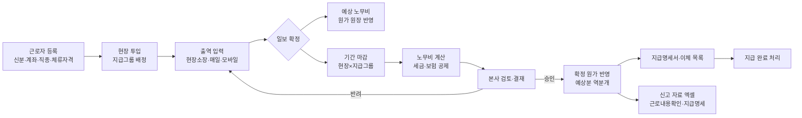

# 노무(일용직) 상세 기획 (v0.1)

작성일: 2026-11-09 · 상위 문서: `docs/01_ERP_기획설계서.md` 3.5절 · 모듈: `internal/hr`

이 문서는 **직영 일용 근로자**의 출역 기록부터 노무비 계산, 현장 원가 반영, 지급까지를 다룹니다. 직원(상용직)의 급여·인사는 `docs/04_직원인사_상세기획.md` 에서 다룹니다. 외주(협력업체) 인력은 `subcontract`(외주비, SUB)로 처리하며 이 문서의 대상이 아닙니다.

---

## 1. 확정된 업무 결정 (2026-11-09 인터뷰)

| 주제 | 결정 | 설계에 미치는 영향 |
|------|------|------------------|
| 지급 방식 | 근로자 **개인별 계좌**로 회사가 직접 지급 | 근로자마다 계좌 보관, 이체 목록 출력 |
| 출역 기록 | **현장소장이 매일** 기록 (작업일보와 함께) | 모바일 입력 속도가 핵심, 전날 출역 복사 |
| 계산 단위 | **공수** (1.0 / 0.5 / 1.5 …) | 노임 = 적용 일당 × 공수 |
| 일당 기준 | **직종별 표준 일당 + 개인 예외** | 직종 단가표와 개인 단가 모두 적용일 이력 관리 |
| 지급 주기 | **현장·팀마다 다름** | 지급그룹(주기 설정)을 두고, 마감은 현장 × 지급그룹 × 기간 |
| 공종 귀속 | **한 사람의 하루 출역에 공종 1개** | 출역 줄마다 `wbs_id`, 기본값은 그 사람의 전날 공종 |
| 원가 반영 시점 | **일보 확정 즉시 예상 반영, 마감 때 확정** | 2단계 원가 반영 (ADR-0001) |
| 원가 범위 | **노임 총액 + 회사 부담 4대보험 + 퇴직공제부금** | 회사가 부담하는 인건비 전체가 현장 원가에 잡힘 |
| 별도 항목 | **식대·교통비 등 수당** 있음 (가불·숙소 공제는 없음) | 수당 종류별 과세 여부 플래그 |
| 외국인 | **있음** | 체류자격·만료일, 보험 적용 여부를 근로자별로 관리 |
| 승인 | 현장소장은 매일 확정, **마감 때 본사가 일괄 검토·결재** | 결재 승인 후 지급 가능, 승인 후 출역 잠금 |
| 1차 범위 | 출역 + 노무비 원가 + 공제 계산 + 지급명세·이체 목록 | 신고는 엑셀 자료 출력까지(서식 자동 제출은 2차) |

---

## 2. 업무 흐름



### 2.1 상태 전이

**출역(labor_attendance)**

| 상태 | 의미 | 누가 | 다음 |
|------|------|------|------|
| `DRAFT` | 입력 중 | 현장소장 | `CONFIRMED` |
| `CONFIRMED` | 일보 확정, 예상 원가 반영됨 | 현장소장 | `DRAFT`(확정 취소, 마감 전만) / `CLOSED` |
| `CLOSED` | 승인된 마감에 포함됨, 수정 불가 | 시스템 | — |

**노무비 마감(payroll_run)**

| 상태 | 의미 | 다음 |
|------|------|------|
| `DRAFT` | 계산됨, 검토 중 (재계산 가능) | `SUBMITTED` |
| `SUBMITTED` | 결재 요청 (출역 수정 차단) | `APPROVED` / `DRAFT`(반려) |
| `APPROVED` | 승인, 확정 원가 반영, 출역 `CLOSED` | `PAID` |
| `PAID` | 지급 완료 처리 | — |

마감이 승인된 뒤 잘못을 발견하면 원래 출역을 고치지 않습니다. **다음 마감에 조정 줄**(음수·양수)로 반영하고 사유를 남깁니다. 지급과 신고가 이미 끝난 금액을 바꾸지 않기 위해서입니다.

---

## 3. 데이터 모델 (`internal/hr`, 마이그레이션 접두 `hr_`)

금액은 모두 `bigint`(원), 공수는 `numeric(4,2)`, 요율은 `numeric(9,6)`입니다. 개인정보 컬럼(`*_enc`)은 애플리케이션에서 암호화해 저장합니다(4장).

### 3.1 기준정보

| 테이블 | 핵심 컬럼 | 비고 |
|--------|----------|------|
| `hr_trade` (직종) | id, code, name, active | 배관공, 덕트공, 용접공, 보온공, 보통인부 … |
| `hr_trade_wage` (직종 표준 일당) | trade_id, daily_wage, effective_from | 적용일 이력. 같은 날짜 중복 금지 |
| `hr_allowance_type` (수당 종류) | code, name, taxable, default_amount | 식대, 교통비, 야간수당 … |
| `hr_rate` (법정 요율·기준값) | code, value, effective_from | 아래 3.4. **코드에 숫자를 하드코딩하지 않음** |

### 3.2 근로자·팀·지급그룹

| 테이블 | 핵심 컬럼 | 비고 |
|--------|----------|------|
| `hr_worker` (일용 근로자) | id, name, id_no_enc, id_no_masked, birth_date, nationality, visa_type, visa_expires_on, phone, bank_code, account_no_enc, account_holder, trade_id, status | 내국인 `id_no`=주민번호, 외국인=외국인등록번호 |
| `hr_worker_wage` (개인 예외 일당) | worker_id, daily_wage, effective_from, reason | 있으면 직종 단가보다 우선 |
| `hr_worker_insurance` (보험 적용 설정) | worker_id, insurance (`NP`/`HI`/`EI`), mode (`AUTO`/`EXEMPT`/`FORCE`), reason | 외국인 상호주의·체류자격, 고령 등 예외용. 기본 `AUTO` |
| `hr_team` (팀) | id, name, leader_worker_id | 입력 편의용 묶음. 지급은 개인별 |
| `hr_pay_group` (지급그룹) | id, project_id, name, period_type (`MONTHLY`/`SEMIMONTHLY`/`WEEKLY`), pay_day_rule | 현장마다 하나 이상 |
| `hr_assignment` (현장 투입) | worker_id, project_id, pay_group_id, from_date, to_date | 출역 입력 시 기본 지급그룹 결정 |

### 3.3 출역·마감

| 테이블 | 핵심 컬럼 | 비고 |
|--------|----------|------|
| `hr_attendance` (출역) | id, project_id, work_date, worker_id, wbs_id, pay_group_id, man_day, applied_wage, wage_amount, status, daily_report_id, confirmed_by/at, payroll_run_id | **applied_wage는 입력 시점 스냅샷**. 나중에 단가표가 바뀌어도 과거 출역은 안 바뀜 |
| `hr_attendance_allowance` (출역 수당) | attendance_id, allowance_type_id, amount, taxable(스냅샷) | |
| `hr_payroll_run` (노무비 마감) | id, project_id, pay_group_id, period_from, period_to, status, submitted/approved by/at, paid_at | (project, pay_group, 기간) 중복·겹침 금지 |
| `hr_payroll_line` (근로자별 지급) | run_id, worker_id, work_days, man_days, wage_total, allowance_taxable, allowance_nontaxable, gross, income_tax, local_tax, np_ee, hi_ee, ltc_ee, ei_ee, net_pay, np_er, hi_er, ltc_er, ei_er, retire_mutual | `_ee`=근로자 부담, `_er`=회사 부담 |
| `hr_payroll_adjustment` (조정) | run_id, worker_id, source_run_id, amount, reason | 승인 후 발견된 오류를 다음 마감에서 정정 |

제약: 한 근로자의 같은 날 출역 공수 합계(모든 현장)는 `hr_rate.MAX_MAN_DAY`(기본 2.0)를 넘을 수 없고, 같은 날 두 현장 출역은 경고합니다.

### 3.4 요율·기준값 (`hr_rate`, 적용일 이력)

| 코드 | 의미 | 비고 |
|------|------|------|
| `DAILY_TAX_DEDUCTION` | 일용근로소득 1일 근로소득공제 | 현행 150,000원 |
| `DAILY_TAX_RATE` | 일용근로소득 세율 | 현행 6% |
| `DAILY_TAX_CREDIT` | 근로소득세액공제율 | 현행 55% |
| `SMALL_TAX_EXEMPT` | 소액부징수 기준 | 현행 1,000원 미만. **판단 단위 확인 필요(8장)** |
| `NP_EE` / `NP_ER` | 국민연금 근로자/회사 | 2026년 고시값 입력 |
| `HI_EE` / `HI_ER` | 건강보험 근로자/회사 | 〃 |
| `LTC_RATIO` | 장기요양보험료 = 건강보험료 × 비율 | 〃 |
| `EI_EE` / `EI_ER` | 고용보험 근로자 / 회사(실업급여분 + 고용안정·직업능력개발분) | 회사분은 기업 규모별로 다름 |
| `RETIRE_MUTUAL_DAILY` | 건설근로자 퇴직공제부금 일액 | 건설근로자공제회 고시값 |
| `INS_MIN_DAYS` | 국민연금·건강보험 일용 적용 최소 근로일수 | 현행 월 8일 |
| `MAX_MAN_DAY` | 1인 1일 최대 공수 | 회사 규칙 |

> 요율 실제 값은 이 문서에 적지 않습니다. 매년 바뀌고 오류가 곧 돈 문제이므로, 연초에 세무사·노무사가 확인한 값을 `hr_rate`에 적용일과 함께 넣습니다. 계산 엔진은 **근무일 기준으로 그 날짜에 유효한 요율**을 씁니다.

---

## 4. 개인정보·권한

주민번호·외국인등록번호·계좌번호는 개인정보보호법상 엄격히 관리해야 하는 정보입니다. 이 정보는 AES-GCM으로 애플리케이션에서 암호화해 저장하고(키는 `.env`, 커밋 금지), 조회 화면에는 마스킹 값(`900101-1******`)만 보입니다. 원문은 **인사·경리 역할이 신고·이체 파일을 만들 때만** 복호화하고, 복호화할 때마다 감사 로그를 남깁니다. 키 관리 방식은 별도 ADR로 남깁니다.

| 역할 | 근로자 정보 | 출역 | 노무비 금액 | 마감 결재 | 이체·신고 파일 |
|------|-----------|------|-----------|----------|--------------|
| 현장소장 | 이름·직종·연락처 (본인 현장 투입자) | 본인 현장 입력·확정 | 본인 현장 노임 합계 | — | — |
| 공무 | 이름·직종 | 담당 현장 조회·수정 | 담당 현장 | 검토·상신 | — |
| 인사 | 전체 (원문 조회 가능) | 전체 | 전체 | 상신 | 생성 |
| 경리 | 계좌 원문 | 조회 | 전체 | — | 이체 파일 생성, 지급 처리 |
| 대표·임원 | 마스킹 | 조회 | 전체 | 승인 | — |

출역·마감 조회 API는 모두 `auth.ProjectScope`를 거칩니다(CLAUDE.md 규칙 5).

---

## 5. 계산 규칙

계산은 `internal/hr` 안의 **DB를 모르는 순수 함수**(`payroll` 패키지)로 만들어 테이블 기반 테스트로 검증합니다. 입력은 출역 목록, 근로자 보험 설정, 그 기간에 유효한 요율입니다. 출력은 `payroll_line`입니다.

### 5.1 노임

```
적용 일당 = 개인 예외 일당(근무일에 유효) ?? 직종 표준 일당(근무일에 유효)
출역 노임 = floor(적용 일당 × 공수)                 -- 원 미만 절사
일 지급액(과세) = 출역 노임 + 과세 수당
```

적용 일당은 **출역을 입력할 때** 정해져 `applied_wage`에 저장됩니다. 단가가 소급해서 바뀌면 인사 담당이 "단가 재적용"을 실행해야 바뀌며(마감 전만 가능), 이 작업은 감사 로그에 남습니다.

### 5.2 소득세·지방소득세 (일 단위 계산)

일용근로소득은 **하루 단위로** 계산합니다.

```
일 소득세   = floor10( max(0, 일 지급액 − 150,000) × 6% × (1 − 55%) )    -- = 초과분 × 2.7%
일 지방소득세 = floor10( 일 소득세 × 10% )
```

`floor10` = 10원 미만 절사입니다. 요율 곱셈은 decimal로 끝까지 계산한 뒤 **마지막에 한 번만** 절사합니다(중간 정수 나눗셈 금지 — 순서에 따라 1~9원 차이가 남). 기간 합계는 일별 값을 더해서 구합니다. 소액부징수는 판단 단위(일별인지 지급 건별인지)를 확인한 뒤 적용합니다.

### 5.3 4대보험

| 보험 | 적용 판단 (AUTO일 때) | 근로자 부담 | 회사 부담 |
|------|--------------------|-----------|----------|
| 고용보험 | 출역이 있으면 적용 | floor10(과세 총액 × `EI_EE`) | floor10(과세 총액 × `EI_ER`) |
| 국민연금 | 같은 현장·같은 달 근로일수 ≥ `INS_MIN_DAYS` (또는 소득 기준) | floor10(× `NP_EE`) | floor10(× `NP_ER`) |
| 건강보험 | 같은 현장·같은 달 근로일수 ≥ `INS_MIN_DAYS` | floor10(× `HI_EE`) | floor10(× `HI_ER`) |
| 장기요양 | 건강보험 적용 시 | floor10(건강보험료 × `LTC_RATIO`) | 〃 |

국민연금·건강보험은 **월 단위 근로일수**로 적용 여부를 판단하므로, 월 2회·주 단위 지급그룹에서는 **그 달 마지막 마감에서** 한꺼번에 계산합니다(앞선 마감에서는 공제하지 않음). 외국인은 `hr_worker_insurance`에서 국적·체류자격에 따른 기본값(`EXEMPT`/`FORCE`)을 정하고 개인별로 바꿀 수 있습니다. 산재보험은 사업장 단위로 신고하는 회사 부담분이라 근로자별로 계산하지 않고, 필요하면 현장 경비로 따로 잡습니다.

### 5.4 퇴직공제부금

```
퇴직공제부금 = 근로일수 × RETIRE_MUTUAL_DAILY      -- 퇴직공제 대상 현장만, 전액 회사 부담
```

현장 마스터에 `retire_mutual_required` 플래그를 둡니다. 0.5공수를 근로일 1일로 셀지는 확인이 필요합니다(8장).

### 5.5 실지급액

```
공제 합계 = 소득세 + 지방소득세 + 국민연금(근로자) + 건강보험(근로자) + 장기요양(근로자) + 고용보험(근로자)
실지급액 = 과세 총액 + 비과세 수당 − 공제 합계 ± 조정
```

실지급액이 0보다 작아지면 마감을 상신할 수 없고 오류를 보여 줍니다.

### 5.6 계산 예시 (골든 테스트 1번)

배관공 A, 적용 일당 250,000원, 한 현장에서 10일 출역 (1.0공수 8일, 1.5공수 1일, 0.5공수 1일), 수당 없음.

| 구분 | 일 지급액 | 일수 | 일 소득세 | 일 지방소득세 |
|------|---------|-----|---------|-------------|
| 1.0공수 | 250,000 | 8 | 2,700 | 270 |
| 1.5공수 | 375,000 | 1 | 6,070 | 600 |
| 0.5공수 | 125,000 | 1 | 0 | 0 |
| **합계** | **2,500,000** | 10 | **27,670** | **2,760** |

1.5공수 줄 계산: (375,000 − 150,000) × 2.7% = 6,075 → 10원 미만 절사하면 6,070원, 지방소득세 607 → 600원. 근로일수가 10일로 8일 이상이므로 국민연금·건강보험이 적용됩니다. 고용보험 근로자분은 2,500,000 × 0.9%(예시 요율) = 22,500원입니다.

### 5.7 필수 경계값 테스트

| 경우 | 기대 |
|------|------|
| 일 지급액 150,000 / 150,001 / 150,370 / 150,371 | 소득세 0 / 0 / 0 (9.99 → 절사) / 10 (소액부징수 적용 전 값) |
| 근로일수 7일 / 8일 | 국민연금·건강보험 미적용 / 적용 |
| 같은 달 두 지급기간(월 2회)에 걸쳐 8일 | 첫 마감 미공제, 두 번째 마감에서 월 전체 기준 공제 |
| 같은 날 다른 현장 출역 | 경고, 공수 합계 > MAX_MAN_DAY 이면 저장 거부 |
| 적용 일당 × 0.5 에서 원 미만 발생 (예: 233,333 × 0.5) | 116,666 (절사) |
| 기간 중 요율 변경 (예: 1월 1일) | 근무일 기준으로 각각의 요율 적용 |
| 기간 중 개인 예외 일당 시작 | 시작일 전/후 출역이 각각 다른 일당 |
| 체류기간 만료 다음 날 출역 입력 | 차단(또는 경고 — 회사 정책 확정 필요) |
| 회사 부담 보험료의 공종 배부 나머지 | 나머지 원은 공수 비중이 가장 큰 공종에 귀속, 배부 합계 = 원금 |
| 승인 후 출역 오류 | 원 출역 수정 불가, 다음 마감 조정 줄 |

---

## 6. 현장 원가 연동

`hr`는 원가 원장에 직접 쓰지 않고 **`acc` 서비스의 `RecordCost(...)`만 호출**합니다(CLAUDE.md 규칙 2). 2단계로 반영합니다(ADR-0001).

| 시점 | 원가 원장에 기록하는 내용 | source_type |
|------|----------------------|-------------|
| 일보 확정 | 출역 줄마다: 노임 + 수당 → `LAB` / 예상 회사부담(고용보험 회사분 + 퇴직공제) → 원가요소는 8장 확인 | `LAB_DAILY` |
| 확정 취소 (마감 전) | 위 금액의 역분개(음수) | `LAB_DAILY` |
| 마감 승인 | ① 기간 내 `LAB_DAILY` 전부 역분개 ② 확정 금액을 공종별로 기록: 노임·수당은 출역 공종 그대로, 회사 부담 보험료·퇴직공제는 근로자별 공수 비중으로 공종에 배부 | `LAB_CLOSE` |

원장은 **추가만 하고 고치지 않습니다**. 그래서 예상 → 확정 차이가 이력으로 남고, 손익 화면은 언제 봐도 `cost_entry` 합계 하나로 계산됩니다. 국민연금·건강보험 회사분은 일보 시점에는 적용 여부를 모르기 때문에 마감 때 처음 나타나며, 이 차이는 "마감 조정"으로 표시합니다.

일보를 확정할 때 그 공종의 노무비 실행예산 소진율이 90%·100%를 넘으면 현장소장과 공무에게 경고를 보여 줍니다(저장은 막지 않음).

모듈 경계: 작업일보(`daily_report`)는 `prj`, 출역은 `hr`가 소유합니다. 일보 화면은 `prj`가 그리고, 출역 저장·확정은 `hr` 서비스(`hr.SaveAttendance`, `hr.ConfirmDay`)를 호출합니다. `hr`는 공종·현장 확인을 위해 `prj` 서비스 인터페이스를 씁니다.

감사 로그(규칙 6): 출역 확정·확정 취소, 단가 변경·재적용, 마감 상신·승인·반려, 지급 완료, 개인정보 복호화.

---

## 7. 화면

| 화면 | 사용자 | 핵심 |
|------|-------|------|
| 출역 입력 (모바일, 일보 탭) | 현장소장 | "어제와 같게" 한 번 누르면 전날 명단·공수·공종 복사 → 빠진 사람만 해제. 팀 단위 일괄 선택. 공수 버튼 0.5 / 1.0 / 1.5. 목표: 20명 현장 1분 |
| 근로자 등록 (모바일 간편) | 현장소장 | 신분증·통장 사진 촬영 → 인사가 본사에서 검수·확정. 미확정 근로자도 출역은 입력 가능(마감 전까지 확정 필요) |
| 근로자 관리 | 인사 | 신분·계좌·직종·개인 단가·보험 예외·체류만료 알림(30일 전) |
| 출역 현황 | 공무·인사 | 현장 × 날짜 달력, 공수 합계, 미확정 일자 표시 |
| 노무비 마감 | 공무·인사 | 기간 선택 → 계산 → 근로자별 표(세금·보험·실지급), 전 기간 대비 변동 강조 → 상신 |
| 지급 | 경리 | 은행 대량이체 파일·지급명세서(근로자별) 출력, 지급 완료 처리 |
| 신고 자료 | 인사 | 근로내용확인신고, 일용근로소득 지급명세서, 퇴직공제 근로일수 신고용 엑셀 |

---

## 8. 확인이 필요한 사항 (실무자·세무사·노무사)

| # | 질문 | 누구에게 | 기본값(답 전까지) |
|---|------|---------|-----------------|
| 1 | 2026년 4대보험 요율, 퇴직공제부금 일액, 고용보험 회사분(기업 규모) | 세무사·노무사 | 값 비워 두고 마감 차단 |
| 2 | 소액부징수(1,000원 미만) 판단을 일별로 하나, 지급 건별로 하나 | 세무사 | 지급 건별 |
| 3 | 국민연금·건강보험 일용 적용 판단을 **현장별 사업장**으로 하나, 회사 전체로 하나 | 노무사 | 현장별 |
| 4 | 회사 부담 보험료·퇴직공제를 원가요소 `LAB`로 볼지 `EXP`(법정경비)로 볼지 — 실행예산 양식과 맞춰야 함 | 공무·경리 | `EXP` + 세부 항목 "법정보험료" |
| 5 | 0.5공수를 퇴직공제 근로일 1일로 신고하나 | 노무사·공제회 | 1일 |
| 6 | 식대 등 수당의 비과세 적용 여부 (일용직) | 세무사 | 전부 과세 |
| 7 | 외국인: 국적별 국민연금 상호주의, 체류자격별 고용보험 적용 기본값 표 | 노무사 | 개인별 수동 설정 |
| 8 | 체류기간 만료 후 출역 입력을 차단할지, 경고만 할지 | 대표·인사 | 차단 |
| 9 | 이체 파일을 만들 은행과 대량이체 양식 | 경리 | — |
| 10 | 지급그룹별 지급일 규칙 (예: 월 마감 → 익월 10일) | 공무·경리 | 마감 승인일 기준 수동 입력 |
| 11 | 같은 근로자가 오래 계속 일할 때 상용직 판단 경고가 필요한가 | 노무사 | 같은 현장 연속 3개월이면 경고 |
| 12 | 전자카드제 현장의 출퇴근 기록을 가져와 대조해야 하나 | 공무 | 2차 |

이 표는 `/to-questionnaire`로 실무자별 설문지를 만들어 보내기에 적합합니다.

---

## 9. 구현 순서 (티켓 단위)

의존성이 적은 것부터 진행합니다. 1번은 DB·다른 모듈 없이 시작할 수 있어 `/tdd`로 첫 작업에 적합합니다.

| # | 작업 | 선행 | 완료 기준 |
|---|------|------|----------|
| 1 | 노무비 계산 엔진 (`hr/payroll`, 순수 함수) | — | 5.6·5.7 테스트 전부 통과 |
| 2 | 기준정보: 직종·직종 단가·수당 종류·요율 (마이그레이션 + CRUD) | Phase 0 기반 | 적용일 조회 테스트 |
| 3 | 근로자 등록 (암호화·마스킹, 외국인, 보험 예외) + 키 관리 ADR | 2 | 원문은 권한자만 복호화, 감사 로그 |
| 4 | 출역 입력·확정 + 원가 예상 반영 | 3, `prj` 현장·공종, `acc.RecordCost` | 일보 확정 시 원장에 `LAB_DAILY` |
| 5 | 노무비 마감·상신·승인 + 확정 원가(역분개·배부) | 1, 4, `wf` 결재 | 원장 합계 = 마감 확정 금액 |
| 6 | 지급명세서·이체 파일·지급 완료 | 5 | 은행 양식 출력 |
| 7 | 신고 자료 엑셀 | 5 | 2차 |

로드맵상 HR은 Phase 4지만, 작업일보(Phase 1)에 출역이 들어가므로 **4번까지는 Phase 1과 함께** 진행하는 것을 권합니다. 그래야 첫 손익 화면부터 노무비가 보입니다.
