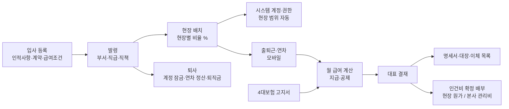

# 직원·인사 상세 기획 (v0.1)

작성일: 2026-11-09 · 상위 문서: `docs/01_ERP_기획설계서.md` 3.5절 · 모듈: `internal/hr` · 짝 문서: `docs/03_노무_상세기획.md`(일용직)

이 문서는 **직원(상용직, 50~100명)**의 조직·발령, 현장 배치와 인건비 배부, 급여 계산, 근태·연차, 자격·교육, 평가·계약을 다룹니다. 일용 근로자는 03 문서, 외주 인력은 외주(SUB)에서 다룹니다.

---

## 1. 확정된 업무 결정 (2026-11-09 인터뷰)

| 주제 | 결정 | 설계에 미치는 영향 |
|------|------|------------------|
| 현재 급여 방식 | **엑셀로 직접 계산**, 매달 오는 4대보험 고지서 금액을 기입 | ERP가 엑셀을 대체. 첫 달은 엑셀과 병행 계산해 비교 |
| 급여 범위 | **급여 계산 전체** (지급·공제 → 실지급, 명세서, 대장, 이체 목록) | 01 설계서의 "외부 급여 프로그램 연계"를 대체 |
| 4대보험 | **자동 계산 + 고지서 대조** | 기준 보수월액으로 계산, 고지서 금액 입력 시 직원별 차이 표시 |
| 급여 항목 | 기본급·고정수당, **현장수당**, 연장·야간·휴일수당, 상여·성과급 | 항목을 코드로 고정하지 않고 "급여 항목 마스터"로 정의 |
| 시간외 수당 | **포괄임금(정액)** | 시간 계산 없음. 단 출퇴근 기록으로 실근로시간을 모니터링(5.3) |
| 퇴직급여 | **퇴직연금 DB형 또는 퇴직금** | 매달 퇴직급여 충당분을 인건비로 잡아 현장 배부 |
| 인건비 배부 | **배치 비율 기준** | 발령 시 현장별 비율(%) 지정, 월 인건비 × 비율 × 배치 일수 |
| 미배치분 | **본사 관리비** | 비율 합이 100% 미만인 날의 나머지는 소속 본사 부서 비용 |
| 출퇴근 | **모바일 출퇴근 + 위치 확인** | 현장·본사 반경 안에서만 출근 버튼 유효 |
| 연차 | **회계연도(1월 1일) 기준** | 입사 첫해 비례 부여, 퇴사 시 입사일 기준과 비교 정산 |
| 인사 범위 | 조직·발령, 근태·연차, 자격·교육·경력, 평가·계약서 **모두** | |
| 평가 | **연 1회, 부서장 입력 → 대표 확정** | |
| 민감정보 | 개인 급여·평가는 **대표 + 인사 담당만** | 현장 손익에는 배부 합계만 (6장) |

---

## 2. 전체 흐름



---

## 3. 조직·발령·현장 배치

### 3.1 조직

부서는 트리입니다(예: 대표 → 공무부 / 공사부 / 견적부 / 구매부 / 관리부). 현장은 부서가 아니고 `prj` 의 현장입니다. 직원은 **항상 하나의 소속 부서**가 있고, 그와 별도로 **현장 배치**를 가집니다.

| 테이블 | 핵심 컬럼 | 비고 |
|--------|----------|------|
| `hr_dept` | id, parent_id, code, name, is_hq_cost_center, active | 본사 관리비가 쌓이는 원가 중심점 |
| `hr_grade` (직급) | code, name, rank | 사원·주임·대리·과장·차장·부장·이사 |
| `hr_position` (직책) | code, name | 팀장·부서장·현장소장 |
| `hr_employee` | id, emp_no(사번), name, rrn_enc, rrn_masked, birth_date, nationality, phone, email, address_enc, bank_code, account_no_enc, hired_on, retired_on, status(`ACTIVE`/`LEAVE`/`RETIRED`), user_id | 개인정보 암호화는 03 문서 4장과 같은 방식 |
| `hr_family` | employee_id, relation, name, birth_date, deductible | 소득세 공제대상 가족 수 산출용 |

### 3.2 발령 (인사 이력)

발령은 **고치지 않고 쌓는** 이력입니다. 현재 상태는 "적용일이 오늘 이전인 마지막 발령"으로 계산합니다.

| 테이블 | 핵심 컬럼 | 비고 |
|--------|----------|------|
| `hr_appointment` | id, employee_id, type, effective_on, dept_id, grade_id, position_id, note, approved_by | type: 입사·부서이동·승진·직책변경·휴직·복직·퇴사 |

발령은 결재(`wf`)를 거쳐 확정합니다. 확정되면 시스템 권한(결재선, 메뉴 권한)이 적용일에 맞춰 자동으로 바뀌고, **퇴사 발령의 적용일 다음 날 0시에 계정이 잠깁니다.**

### 3.3 현장 배치

| 테이블 | 핵심 컬럼 | 비고 |
|--------|----------|------|
| `hr_staff_assignment` | id, employee_id, project_id, role, ratio_pct, from_date, to_date, note | role: 현장대리인·현장소장·공무·공사·품질·안전 |

규칙은 이렇습니다.

1. 한 직원의 **같은 날짜 배치 비율 합은 100%를 넘을 수 없습니다.** 100% 미만이면 나머지는 소속 부서(본사 관리비)입니다.
2. 비율은 정수 %(1~100)입니다. 겸임은 50/50, 70/30처럼 지정합니다.
3. 배치 이력은 세 군데에 쓰입니다.
   - 인건비 배부의 기준 (4.7)
   - 건설기술인 경력 신고 자료 (7장)
   - **`auth.ProjectScope` 자동 결정**: 그날 배치된 현장은 자동으로 조회 범위에 들어갑니다. 발령마다 권한을 손으로 바꾸지 않습니다. 배치가 끝난 현장은 종료 후 30일 동안 읽기 전용으로 남깁니다(기성·정산 마무리용, 기간은 설정값).

---

## 4. 급여

### 4.1 급여 항목 마스터

항목은 코드에 고정하지 않고 표로 정의합니다. 엑셀 파일을 받으면 이 표를 그 엑셀 항목에 맞춰 채웁니다.

| 테이블 | 핵심 컬럼 |
|--------|----------|
| `hr_pay_item` | code, name, kind(`EARNING`/`DEDUCTION`), taxable, nontax_limit(월 비과세 한도), ordinary_wage(통상임금 포함 여부), calc(`FIXED`/`DAILY_PRORATE`/`INPUT`/`FORMULA`), insurance_base(보험 보수 포함 여부), sort |

초기 항목 예시입니다(실제 항목은 엑셀 확인 후 확정).

| 항목 | 종류 | 과세 | 계산 | 비고 |
|------|------|------|------|------|
| 기본급 | 지급 | 과세 | 고정(일할) | |
| 직책수당 / 자격수당 | 지급 | 과세 | 고정(일할) | 자격수당은 자격증 보유 시 자동 (7장) |
| 식대 | 지급 | 비과세(한도 내) | 고정 | 한도 초과분은 과세 |
| 차량유지비 | 지급 | 비과세(요건·한도 내) | 고정 | 본인 차량 업무 사용 요건 |
| 현장수당 | 지급 | 과세(원칙) | **배치 일수 연동** | 4.3 |
| 포괄 연장·야간·휴일수당 | 지급 | 과세 | 고정 | 근로계약서의 포괄 시간·금액 |
| 상여 / 성과급 | 지급 | 과세 | 입력 | 지급월에만 |
| 국민연금·건강보험·장기요양·고용보험 | 공제 | — | 4.4 | |
| 소득세 / 지방소득세 | 공제 | — | 4.5 | |
| 기타 공제 | 공제 | — | 입력 | 가불, 경조회비 등 |

비과세 한도는 매년 바뀌므로 `hr_rate` 에 적용일과 함께 넣습니다(03 문서 3.4와 같은 표).

### 4.2 직원별 급여 조건

| 테이블 | 핵심 컬럼 | 비고 |
|--------|----------|------|
| `hr_salary_term` | employee_id, effective_from, annual_salary, pay_item_code, monthly_amount, contract_id | 연봉 계약 단위로 항목별 월 금액. 적용일 이력 |
| `hr_insurance_base` | employee_id, insurance, base_monthly, effective_from | 공단에 신고한 기준 보수월액(국민연금 기준소득월액, 건강보험 보수월액) |

### 4.3 일할·현장수당 규칙

```
일할 금액 = floor( 월 고정액 × 재직 일수 ÷ 그 달 일수 )         -- 원 미만 절사
현장수당   = floor( 월 현장수당 × 현장 배치 일수 ÷ 그 달 일수 )
```

- 재직 일수는 입사일·퇴사일·무급휴직을 뺀 일수입니다.
- 일할 기준(그 달 실제 일수 / 30일 고정)은 회사 규정을 확인해야 합니다(10장). 기본값은 실제 일수입니다.
- 현장수당은 배치 비율과 무관하게 **배치된 날이면 1일**로 셉니다(겸임자도 현장에 나간 날 기준). 이 부분도 확인이 필요합니다.

### 4.4 4대보험 — 자동 계산 + 고지서 대조

공단은 **직원이 신고한 기준 보수월액**으로 보험료를 고지합니다. 그래서 그 달에 실제로 받은 급여와 고지 금액이 다를 수 있습니다(상여 달, 입사·퇴사 달, 보수월액 변경 신고 전 등). 지금 엑셀에서 고지서 금액을 기입하시는 이유가 이것입니다. ERP는 아래 순서로 처리합니다.

1. **자동 계산**: `hr_insurance_base` × 그 달 요율(`hr_rate`)로 직원별 근로자·회사 부담분을 계산합니다. 국민연금은 기준소득월액 상·하한을 적용합니다.
2. **고지서 입력**: 공단 고지서의 사업장 총액을 보험별로 입력합니다. 4대보험 정보연계센터(EDI)에서 받은 직원별 고지 내역 엑셀을 올리면 직원별 금액까지 들어갑니다.
3. **대조**: 직원별로 "계산 vs 고지" 차이를 보여 주고, 차이가 있는 직원을 맨 위에 표시합니다. 입사·퇴사, 보수월액 변경, 정산 같은 이유를 함께 보여 줍니다.
4. **공제 금액 결정**: 설정에 따라 **고지 금액을 공제**합니다(기본값, 지금 방식과 같음). 고지서가 아직 없으면 계산 금액으로 임시 계산하고, 고지서가 들어오면 다시 계산합니다.
5. **연말·퇴사 정산**: 건강보험 연말정산이나 퇴사자 정산 고지가 오면 정산분을 별도 항목(건강보험 정산)으로 공제하거나 환급합니다.

| 테이블 | 핵심 컬럼 |
|--------|----------|
| `hr_insurance_notice` | year_month, insurance, total_ee, total_er, uploaded_file_id |
| `hr_insurance_notice_line` | notice_id, employee_id, ee_amount, er_amount, note |

산재보험은 회사 전액 부담이고 사업장 단위로 고지되므로, 고지 총액을 직원 인건비 비율로 나눠 배부합니다.

### 4.5 소득세

```
소득세     = 근로소득 간이세액표( 월 과세 급여, 공제대상 가족 수 ) × 원천징수 비율(80/100/120%)
지방소득세 = floor10( 소득세 × 10% )
```

간이세액표는 국세청이 매년 내는 큰 표이므로 **코드에 넣지 않고 데이터로 가져옵니다**(`hr_tax_table`, 연도별). 원천징수 비율은 직원이 고를 수 있게 합니다. 연말정산은 1차 범위 밖이며, 근로소득 지급 자료를 엑셀로 내보내 세무사·홈택스에서 처리합니다.

### 4.6 월 급여 마감과 상태

| 테이블 | 핵심 컬럼 |
|--------|----------|
| `hr_salary_run` | year_month, pay_date, status(`DRAFT`/`SUBMITTED`/`APPROVED`/`PAID`), approved_by/at |
| `hr_salary_line` | run_id, employee_id, item_code, amount, base_note |
| `hr_salary_summary` | run_id, employee_id, gross, taxable, nontaxable, total_deduction, net_pay, er_insurance, retire_accrual, labor_cost_total |

상태 전이는 일용직 노무비 마감(03 문서 2.1)과 같습니다. 승인 후 오류는 **다음 달 소급 항목**으로 바로잡고, 승인된 급여는 고치지 않습니다. 출력물은 급여명세서(직원별, 근로기준법상 교부 의무), 급여대장, 은행 대량이체 파일, 원천징수 자료입니다. 첫 1~2개월은 지금 엑셀과 **병행 계산해서 직원별 금액이 1원까지 같은지** 비교하는 기능을 둡니다.

### 4.7 직원 인건비와 현장 배부

```
월 인건비(직원 1명) = 지급 총액(과세 + 비과세)
                    + 회사 부담 4대보험(국민연금·건강·장기요양·고용, 산재 배부분)
                    + 퇴직급여 충당분
```

퇴직급여 충당분은 DB형·퇴직금이므로 매달 실제로 돈이 나가지 않지만, 비용은 발생하고 있습니다. 기본값은 `floor10(그 달 지급 총액 ÷ 12)` 이고, 회계사와 확인해 바꿀 수 있게 설정값으로 둡니다.

배부는 **배치 비율 × 배치 일수**로 가중치를 만들어 나눕니다.

```
가중치(현장 p) = Σ 그 달 각 날짜의 p 배치 비율(%)
가중치(본사)   = Σ 그 달 각 날짜의 (100% − 그날 배치 비율 합)    -- 재직일만
배부액(p)      = floor( 월 인건비 × 가중치(p) ÷ 가중치 합 )
나머지 원      = 가중치가 가장 큰 곳에 더함                     -- 배부 합계 = 월 인건비
```

현장 배부분은 `acc.RecordCost` 로 원가 원장에 기록하고, 본사분은 해당 부서 관리비로 기록합니다. 기록 시점은 ADR-0002(예상 → 확정)를 따릅니다.

### 4.8 계산 예시 (골든 테스트)

**예시 1 — 배부.** 11월(30일), 현장소장 김 과장, 월 인건비 4,745,670원(급여 4,000,000 + 회사 부담 보험 412,340 + 퇴직 충당 333,330, 금액은 예시). 11/1~11/20은 A현장 100%, 11/21~11/30은 B현장 50%입니다.

| 배부처 | 가중치 | 배부액 |
|-------|------|-------|
| A현장 | 20일 × 100 = 2,000 | 3,163,780 |
| B현장 | 10일 × 50 = 500 | 790,945 |
| 본사(공사부) | 10일 × 50 = 500 | 790,945 |
| 합계 | 3,000 | **4,745,670** |

**예시 2 — 일할.** 기본급 3,100,000원, 11월 16일 입사 → 3,100,000 × 15 ÷ 30 = **1,550,000원**.

### 4.9 필수 경계값 테스트

| 경우 | 기대 |
|------|------|
| 같은 날 배치 비율 합 100% / 101% | 저장 / 거부 |
| 배치 비율 합 0%인 달 (본사 근무) | 전액 본사 관리비 |
| 배부 나머지 원 발생 (3곳 1/3씩) | 나머지는 가중치 최대 → 동률이면 현장 우선, 현장끼리면 코드순. 합계 = 원금 |
| 입사일 = 1일 / 말일 | 전액 / 1일분 |
| 퇴사일 = 말일, 다음 달 1일 계정 상태 | 다음 날 0시 잠금 |
| 2월(28·29일)·31일 달 일할 | 실제 일수 기준으로 계산 |
| 비과세 식대 한도 초과 | 초과분만 과세로 이동 |
| 국민연금 기준소득월액 상·하한 경계 | 상한·하한 값으로 고정 |
| 고지서 미입력 상태에서 계산 → 고지서 입력 후 재계산 | 공제가 고지 금액으로 바뀌고 차이 내역 남음 |
| 승인 후 금액 오류 | 원 급여 수정 불가, 다음 달 소급 항목 |
| 무급휴직 기간이 낀 달 | 휴직 기간 일할 제외, 인건비 배부 가중치에서도 제외 |

---

## 5. 근태·연차

### 5.1 모바일 출퇴근 + 위치 확인

- 출근·퇴근 버튼을 누를 때 **그 순간의 위치만** 받아 그날 배치된 현장(또는 본사) 반경 안인지 확인합니다. 계속 위치를 추적하지 않습니다.
- 현장 좌표와 반경(기본 300m)은 `prj` 현장 마스터에 둡니다.
- 반경 밖이면 "사유 입력 후 출근"으로 처리하고 부서장 확인 대상에 올립니다(외근, 자재 수령, 발주처 회의 등).
- 위치정보 수집은 **입사 시 동의**를 받아야 하며, 동의 기록을 보관합니다. 위치 원본은 보관 기간(기본 1년, 확인 필요)이 지나면 지웁니다.

| 테이블 | 핵심 컬럼 |
|--------|----------|
| `hr_clock` | employee_id, work_date, kind(`IN`/`OUT`), at, lat, lng, place_type(`PROJECT`/`HQ`/`OTHER`), project_id, in_range, reason |
| `hr_workday` | employee_id, work_date, status(근무·연차·반차·출장·휴직·결근), first_in, last_out, work_minutes, place_project_id |

현장 직원의 출근 기록이 생기면 그날 작업일보의 "관리 인원"에 자동으로 표시됩니다(일보는 `prj`, 조회는 `hr` 서비스).

### 5.2 연차 (회계연도 기준)

법정 연차 규칙(1년 미만 월 1일, 1년 이상 15일, 3년 이상 2년마다 1일 가산, 최대 25일)을 **회계연도 방식**으로 적용합니다. 계산은 규칙 함수로 만들고, 아래 처리 방식은 노무사 확인 후 설정값으로 고정합니다.

1. 매년 1월 1일 재직자 전원에게 일괄 부여합니다.
2. 입사 첫해 입사자는 1년 미만 월차(매월 개근 시 1일)를 받고, 다음 해 1월 1일에 **전년도 재직 비율만큼 비례 연차**를 받습니다. 예: 2026-07-01 입사 → 2027-01-01에 15 × 184/365 ≈ 7.56일. 소수점 처리(올림·0.5일 단위)는 회사 규정으로 정합니다.
3. **퇴사할 때는 입사일 기준으로 다시 계산해서**, 입사일 기준이 더 많으면 그 차이를 미사용 연차 수당으로 정산합니다(퇴사자 불이익 금지).
4. 연차 신청·승인은 전자결재(`wf`)로 합니다. 반차(0.5일)를 허용합니다.
5. 연차 사용 촉진 통지(사용 권고) 일정을 알림으로 띄웁니다.

| 테이블 | 핵심 컬럼 |
|--------|----------|
| `hr_leave_grant` | employee_id, year, kind(`ANNUAL`/`MONTHLY`/`ADJUST`), days, granted_on, expires_on, basis_note |
| `hr_leave_use` | employee_id, date, days(1.0/0.5), approval_id |

### 5.3 포괄임금과 근로시간 모니터링

시간외 수당은 포괄 정액이라 급여 계산에 시간이 들어가지 않습니다. 하지만 **주 52시간 한도와 포괄 계약 시간을 넘는지**는 출퇴근 기록으로 확인할 수 있습니다. 주간 근로시간이 계약상 포괄 시간이나 52시간에 가까워지면 본인·부서장·인사에게 경고합니다. 포괄임금 계약은 실근로시간이 약정 시간을 넘으면 차액을 줘야 하는 위험이 있고, 관련 법 개정 논의도 있었으므로 현행 기준은 노무사 확인이 필요합니다(10장).

---

## 6. 권한과 민감정보

| 정보 | 대표 | 인사 | 부서장 | 현장소장 | 경리 | 본인 |
|------|-----|-----|-------|---------|-----|-----|
| 인적사항(마스킹) | ○ | ○ | 소속 부서 | 배치 인원 | — | ○ |
| 주민번호·계좌 원문 | — | ○ (복호화 로그) | — | — | 이체 파일 생성 시만 | — |
| 개인 급여·연봉 | ○ | ○ | — | — | — | 본인 명세서 |
| 인사평가 | ○ (확정) | ○ | 본인이 입력한 평가만 | — | — | 공개 정책에 따름 |
| 출퇴근·연차 | ○ | ○ | 소속 부서 | 배치 인원 | — | ○ |
| 현장 손익의 직원 인건비 | ○ | ○ | 담당 현장 | **합계만** | ○ (합계) | — |

경리는 이체 파일을 만들 때만 계좌 원문을 쓰며, 개인 급여 화면은 볼 수 없습니다. 이체 파일에는 이름·계좌·금액만 들어갑니다. 경리가 이체 금액으로 개인 급여를 추정할 수 있다는 점은 감안해야 합니다(10장).

**주의할 점:** 현장에 배치된 직원이 한 명뿐이면 "직원 인건비 합계"가 곧 그 사람의 인건비입니다. 그래서 현장소장 권한에서는 직원 인건비를 **"현장 관리비" 한 줄로 묶어 보이는 옵션**을 둡니다(10장).

감사 로그(CLAUDE.md 규칙 6) 대상은 급여 조건 변경, 급여 마감 상신·승인, 고지서 반영, 배치 비율 변경, 발령 확정, 개인정보 복호화, 평가 확정입니다.

---

## 7. 자격증·교육·경력

| 테이블 | 핵심 컬럼 | 비고 |
|--------|----------|------|
| `hr_cert_type` | code, name, issuer, renewal_years, pay_item_code | 공조냉동기계기사, 배관기능사, 에너지관리기사, 기계설비유지관리자, 소방설비기사(기계) … |
| `hr_cert` | employee_id, cert_type_id, cert_no, acquired_on, expires_on, file_id | 사본 파일 보관 |
| `hr_training` | employee_id, kind, title, completed_on, hours, next_due_on, file_id | 법정 안전교육, 기계설비유지관리자 보수교육 등 |
| `hr_career` | employee_id, company, from, to, role, note | 입사 전 경력 |

자격증·교육은 만료 **90일·30일 전**에 본인과 인사에게 알림을 보냅니다. 자격수당이 걸린 자격증은 보유 기간에만 자동으로 지급 항목에 들어갑니다. 건설기술인 경력 신고(건설기술인협회)용 엑셀은 배치 이력(3.3)과 자격증으로 만듭니다.

---

## 8. 인사평가·계약서

### 8.1 평가 (연 1회, 부서장 → 대표)

| 테이블 | 핵심 컬럼 |
|--------|----------|
| `hr_eval_template` | year, items(항목·가중치·척도) |
| `hr_eval` | year, employee_id, evaluator_id, status(`DRAFT`/`SUBMITTED`/`CONFIRMED`), scores, comment, final_grade, confirmed_by |

평가자는 그 해 말 기준 소속 부서장입니다. 현장 직원은 현장소장을 1차 평가자로 지정할 수 있습니다. 평가 화면에는 참고 자료로 그 직원의 배치 현장, 근태 요약, 자격 취득을 보여 줍니다. 현장 손익을 평가에 연결할지는 10장에서 확인합니다. 평가 결과는 다음 연봉 계약(`hr_salary_term`)을 만들 때 참고 화면에 보입니다.

### 8.2 계약서

| 테이블 | 핵심 컬럼 |
|--------|----------|
| `hr_contract` | employee_id, kind(근로계약·연봉계약·비밀유지 등), from, to, annual_salary, inclusive_ot_hours, file_id, signed_on |

근로계약서·연봉계약서 서명본(PDF)을 보관하고, 계약 만료 60일 전에 알림을 보냅니다. 연봉계약을 등록하면 `hr_salary_term` 이 같이 생성됩니다(같은 화면). 전자서명은 2차 범위입니다.

---

## 9. 화면

| 화면 | 사용자 | 핵심 |
|------|-------|------|
| 직원 카드 | 인사 | 인적사항·발령·배치·급여조건·자격·계약·평가를 탭으로 한 화면에 |
| 조직도 | 전 직원 | 부서 트리, 현장별 배치 인원 |
| 현장 배치판 | 공무·인사·대표 | 현장 × 월 그리드에 직원과 비율 표시, 드래그로 기간 조정, 비율 100% 초과 표시 |
| 출퇴근 (모바일) | 전 직원 | 큰 출근/퇴근 버튼, 위치 결과, 이번 주 근로시간 |
| 연차 (모바일) | 전 직원 | 잔여 연차, 신청 → 결재 |
| 급여 마감 | 인사 | 월 선택 → 계산 → 고지서 대조 → 전월 대비 변동 강조 → 상신 |
| 고지서 대조 | 인사 | 보험별 사업장 총액, 직원별 계산·고지 차이와 사유 |
| 급여명세서 | 본인 | 모바일 조회·PDF |
| 만료 알림판 | 인사 | 자격·교육·계약·체류(일용직 포함) 만료 예정 |

---

## 10. 확인이 필요한 사항

| # | 질문 | 누구에게 | 기본값(답 전까지) |
|---|------|---------|-----------------|
| 1 | 지금 쓰는 **급여 엑셀 파일**(항목·수식) — 받으면 4.1 항목표와 병행 검증 데이터로 사용 | 인사 | 일반 항목으로 설계 |
| 2 | 일할 계산 기준: 실제 일수 / 30일 고정 / 근무일수 | 인사·노무사 | 실제 일수 |
| 3 | 현장수당 지급 기준: 배치 일수 / 출근 일수 / 월 정액, 겸임자 처리 | 인사 | 배치 일수, 겸임도 1일 |
| 4 | 직원 인건비의 원가요소: `LAB`(노무비) / `EXP`(현장관리비·간접노무비) — 실행예산 양식과 맞춤. 01 설계서 4.2는 LAB | 공무·경리 | `LAB`, 세부 "직원 배부" |
| 5 | 직원 배부는 공종 없이 현장 단위로 기록 — 공종 트리에 "M99 현장공통" 노드를 추가할지 | 공무 | M99 추가 |
| 6 | 퇴직급여 충당분 계산 방식 (월 지급총액 ÷ 12 / 결산 시 추계액 기준) | 회계사 | ÷ 12 |
| 7 | 포괄임금 계약 내용(포함 시간·금액)과 현행 법 기준 적합 여부 | 노무사 | 계약서 값으로 모니터링만 |
| 8 | 회계연도 연차의 입사 첫해 비례 부여 소수점 처리 | 노무사 | 0.5일 단위 올림 |
| 9 | 위치정보 동의서 문안과 위치 기록 보관 기간 | 노무사 | 1년 |
| 10 | 현장소장에게 직원 인건비를 보여 줄지, "현장 관리비"로 묶을지 | 대표 | 묶어서 표시 |
| 11 | 평가 결과를 본인에게 공개하는지, 현장 손익을 평가 참고 자료로 보여 줄지 | 대표 | 비공개, 참고 자료로 표시 |
| 12 | 급여일, 이체 은행, 경리가 이체 파일을 만들 때 금액이 보이는 것을 허용할지 | 대표·경리 | 매월 10일, 허용 |
| 13 | 연말정산을 계속 세무사에게 맡기는지 | 경리 | 맡김 (자료 엑셀 출력) |

---

## 11. 구현 순서 (티켓 단위)

| # | 작업 | 선행 | 완료 기준 |
|---|------|------|----------|
| 1 | 직원·부서·직급·발령 + 계정 연동(퇴사 잠금) | Phase 0 인증 | 발령 적용일에 권한 변경 |
| 2 | 현장 배치(비율) + `auth.ProjectScope` 자동 결정 | 1, `prj` 현장 | 배치 현장만 조회되는 권한 테스트 |
| 3 | 배부 계산 엔진 (순수 함수) | — | 4.8 예시 1, 4.9 배부 경계값 |
| 4 | 급여 계산 엔진 (순수 함수: 일할·비과세·보험·간이세액) | — | 엑셀 병행 데이터와 1원 일치 |
| 5 | 급여 항목·조건·고지서 입력/대조 + 월 마감·결재 | 4, `wf` | 명세서·대장·이체 파일 |
| 6 | 인건비 확정 배부 → 원가 원장 (ADR-0002) | 3, 5, `acc.RecordCost` | 원장 배부 합계 = 월 인건비 합계 |
| 7 | 모바일 출퇴근(위치) + 근무일 | 2 | 반경 판정 테스트 |
| 8 | 연차 부여·사용·퇴사 정산 | 7 | 회계연도·입사일 비교 테스트 |
| 9 | 자격·교육·계약 + 만료 알림 | 1 | |
| 10 | 인사평가 | 1 | |

3번과 4번은 DB 없이 `/tdd`로 바로 시작할 수 있습니다. 4번은 급여 엑셀(10장 1번)을 받으면 정답 데이터가 생기므로, 엑셀이 오기 전에는 3번(배부)부터 하는 것을 권합니다.
