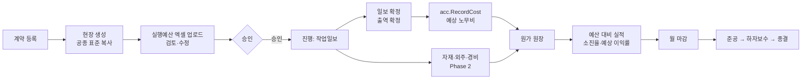

# 현장·원가 상세 기획 (v0.1) — Phase 1 "현장의 뼈대"

작성일: 2026-11-10 · 상위 문서: `docs/01_ERP_기획설계서.md` 3.2·3.4·4·5절 · 모듈: `internal/prj`, `internal/acc`

이 문서는 현장 마스터, 계약, 공종, 실행예산, 작업일보, 원가 원장, "예산 대비 실적" 화면을 다룹니다. 일용직 출역과 노무비 계산은 `03_노무_상세기획.md`, 직원 인건비 배부는 `04_직원인사_상세기획.md`와 ADR-0002를 따르고, 여기서는 연결점만 적습니다. 자재·외주·기성은 `06_자재_외주_기성_상세기획.md`, 견적·수주는 `07_영업_견적_상세기획.md`입니다.

**표기**: ✅ = 기존 문서에서 이미 정해진 것. ⏳ = 담당자 답이 오기 전까지 쓰는 기본값이고, 괄호는 질문지 번호입니다. 답이 오면 ⏳를 ✅로 바꾸고 질문지의 상태 줄도 함께 바꿉니다.

| 약칭 | 질문지 파일 |
|------|------------|
| 현장1 / 현장2 | `question-현장기획.md` / `question-현장기획-2차.md` |
| 1단계 | `question-1단계-원가원장.md` |
| 2단계 | `question-2단계-자재외주기성.md` (06 문서) |
| 공무경리 | `question-공무경리.md` |

---

## 1. 결정 목록

| 주제 | 결정 | 상태 |
|------|------|------|
| 원가 기록 | 모든 원가는 `acc.RecordCost` 로만 기록, 원장은 추가만 | ✅ CLAUDE.md 규칙 2 |
| 금액 | 원 단위 `int64`. 계약·예산·원가는 부가세 별도(공급가액) 기준 | 타입 ✅ / 부가세 별도 ⏳ (현장2-3) |
| 현장과 계약 | 계약 1건 = 현장 1개. 입찰·견적 단계는 현장이 아님 | ⏳ (현장1-5) |
| 현장 상태 | 계약 → 진행 → 준공 → 하자보수 → 종결, 상태별 입력 제한 | ⏳ (현장1-3, 현장1-4) |
| 공종 | 회사 표준 9개(M01~M09) + `M99 현장공통`, 현장별 하위 추가 | ⏳ (현장2-1, 현장2-2, 공무경리-3) |
| 작업일보 단위 | 현장 × 날짜 1건, 공종별 내용은 그 안의 줄 | ⏳ (현장1-6) |
| 일보 확정 | 확정 = 출역 확정 = 예상 노무비 원장 기록, 확정 취소는 노무비 마감 전까지 | 흐름 ✅ (03 문서 2.1, ADR-0001) / 수정 범위 ⏳ (현장1-7) |
| 일보 항목 | 필수: 날씨·공종별 작업 내용·출역. 선택: 장비·사진·특이사항 | ⏳ (현장2-11) |
| 일보 소급 | 당일부터 3일 안은 현장소장, 이후는 공무 승인 | ⏳ (현장2-13) |
| 실행예산 | 엑셀 업로드 → 검토 → 승인. 승인본은 고치지 않고 새 버전 | ⏳ (현장1-8, 현장1-10) |
| 예산 승인 | 전자결재(WF) 전에는 지정 권한자의 승인 버튼 | ⏳ (현장1-9) |
| 소진율 경고 | 90% 초과 주의, 100% 초과 경고, 저장은 막지 않음 | 노무비 ✅ (03 문서 6장) / 전체 확대 ⏳ (현장2-8) |
| 예상 최종원가 | 월 1회 입력한 현장 전체 공정률로 계산 | ⏳ (현장2-9, 1단계-8) |
| 열람 범위 | 현장소장은 원가·소진율만. 계약금액·이익률은 공무·임원·대표 | 계약 단가 ✅ (01 설계서 6장) / 이익률 ⏳ (현장2-10) |
| 진행 중 현장 | 시작일 기준 "개시 원가"를 공종 × 원가요소별로 입력 | ⏳ (1단계-1) |
| 월 마감 | 경리가 월 단위로 원가를 잠그고, 정정은 다음 달 조정 줄 | ⏳ (1단계-2) |
| 현장 조회 권한 | 현장 담당자 지정으로 임시 결정, HR 배치 완성 후 교체 | **미결** (개발 쪽 결정, 4.4) |

---

## 2. 업무 흐름



---

## 3. 현장·계약·공종

### 3.1 현장 마스터

| 테이블 | 핵심 컬럼 | 비고 |
|--------|----------|------|
| `project` | id, code, name, client_id, status, address, lat, lng, geofence_m, start_on, end_on, completed_on, closed_on | 위치와 반경(기본 300m)은 모바일 출퇴근 확인에 쓴다(04 문서 5.1). 현장 코드는 기본 `연도2자리-일련번호`(예: `26-001`) ⏳ (1단계-4) |
| `project_member` | project_id, user_id, role(`SITE_MANAGER`/`PM`), from_date, to_date | 현장소장·공무 담당. 여러 명 지정 가능 ⏳ (1단계-5) |

### 3.2 상태와 입력 제한

| 상태 | 일보 입력 | 실행예산 | 원가 기록 | 다음 |
|------|:---:|:---:|:---:|------|
| `CONTRACT` 계약 | 불가 | 편성·승인 | 불가 | `ACTIVE` (예산 승인 후 착공 처리) |
| `ACTIVE` 진행 | 가능 | 새 버전 가능 | 가능 | `COMPLETED` (미확정 일보 0건일 때) |
| `COMPLETED` 준공 | 불가 | 불가 | 이미 발생한 거래의 정산만 | `DEFECT` |
| `DEFECT` 하자보수 | 불가 | 불가 | 경비만 | `CLOSED` |
| `CLOSED` 종결 | 불가 | 불가 | 불가 | — |

종결은 미수금과 유보금 잔액이 0원일 때만 가능합니다. 예외는 공무가 사유를 남기고 처리합니다 ⏳ (1단계-7). 상태 변경은 감사 로그를 남깁니다(규칙 6).

### 3.3 계약

| 테이블 | 핵심 컬럼 | 비고 |
|--------|----------|------|
| `contract` | id, project_id, client_id, kind(`GC_SUB`/`OWNER_DIRECT`), amount, signed_on, start_on, end_on, advance_amount, ld_rate, retention_rate, defect_months | `amount`는 공급가액 `bigint`. 비율은 `numeric`. `kind`는 원도급 하도급 / 건축주 직접 구분 ⏳ (2단계-1) |
| `contract_change` | id, contract_id, seq, changed_on, delta_amount, amount_after, reason, approved_by | **추가만**. 현재 계약금액 = 마지막 `amount_after` |

설계변경으로 계약금액이 바뀌어도 실행예산은 자동으로 바뀌지 않습니다. 공무가 필요할 때 새 버전을 만듭니다 ⏳ (현장2-5). 첫 단계의 계약 항목은 위 표가 전부이고, 보증서는 뺍니다 ⏳ (현장2-6).

### 3.4 공종 (`wbs`)

`wbs(id, project_id[null=회사 표준], parent_id, code, name)`. 현장을 만들 때 회사 표준을 복사하고, 현장별로 하위 공종을 추가합니다. 표준은 01 설계서 4.1의 M01~M09에 직원 인건비 배부용 `M99 현장공통`을 더합니다 ⏳. 이미 쓴 공종은 삭제하지 않고 `active=false`로 숨깁니다.

---

## 4. 실행예산

### 4.1 모델

| 테이블 | 핵심 컬럼 | 비고 |
|--------|----------|------|
| `budget_version` | id, project_id, version, status(`DRAFT`/`APPROVED`/`SUPERSEDED`), approved_by/at, note | 현장당 `APPROVED`는 하나뿐 |
| `budget_item` | version_id, project_id, wbs_id, cost_type, amount | `(version_id, wbs_id, cost_type)` 유일. `amount`는 0 이상 |

### 4.2 엑셀 업로드

1. 엑셀을 올리면 열 매핑 화면에서 공종 코드/이름, 재료비·노무비·외주비·경비 열을 지정합니다. 매핑은 저장해서 다음에 재사용합니다.
2. 검증: 공종을 찾지 못한 행, 음수·소수 금액, 같은 공종·원가요소 중복을 행 번호와 함께 보여 줍니다. 오류가 있으면 `DRAFT`로 저장하지 못합니다.
3. 합계(공종별, 원가요소별, 전체)와 계약금액 대비 비율을 보여 줍니다.
4. 승인하면 `APPROVED`가 되고, 이전 승인본은 `SUPERSEDED`가 됩니다. 승인자는 지정된 권한자(처음에는 대표)이고, 금액 구간별 승인자는 `approval_rule` 표(06 문서 5.4)로 둡니다. WF가 생기면 그쪽으로 넘깁니다 ⏳ (현장1-9).
5. 승인본은 고치지 않습니다. 바꾸려면 새 `DRAFT` 버전을 만들고, 이전 버전 값을 복사해 시작합니다. 소진율은 항상 현재 승인본 기준입니다.

감사 로그: 업로드, 승인, 새 버전 생성.

---

## 5. 작업일보

### 5.1 모델

| 테이블 | 핵심 컬럼 | 비고 |
|--------|----------|------|
| `daily_report` | id, project_id, report_date, status(`DRAFT`/`CONFIRMED`), weather, remark, confirmed_by/at | `(project_id, report_date)` 유일 |
| `daily_report_work` | report_id, wbs_id, content | 공종별 작업 내용 줄 |
| `daily_report_crew` | report_id, partner_id, headcount | 협력업체 인원수만 (금액은 외주 기성에서) ⏳ (현장2-12) |
| `daily_report_equipment` | report_id, name, qty | 선택 |
| `attachment` | owner_type, owner_id, file_id | 사진. 일보당 최대 20장, 긴 변 1920px로 줄여 저장 ⏳ (1단계-11) |

직영 일용직 출역(`hr_attendance`)과 관리 인원(직원 출근)은 `hr`가 소유하고, 일보 화면이 `hr` 서비스로 읽고 씁니다(03 문서 6장, 04 문서 5.1).

### 5.2 확정과 수정

- **확정**: 필수 항목이 모두 있으면 확정합니다. `prj`가 `hr.ConfirmDay`를 호출하고, `hr`가 `acc.RecordCost`로 `LAB_DAILY`를 기록합니다. 한 트랜잭션에서 하나라도 실패하면 확정되지 않습니다.
- **확정 후 수정**: 날씨·사진·특이사항·작업 내용 글은 고칠 수 있고 변경 이력을 남깁니다. 출역과 금액이 걸린 항목은 확정을 취소해야 고칠 수 있고, 취소는 노무비 마감 전까지입니다 ⏳ (현장1-7).
- **소급**: `report_date`가 오늘보다 3일 넘게 이전이면 공무 승인 후에 입력합니다 ⏳ (현장2-13). 원가 월 마감이 끝난 달의 일보는 입력하지 못합니다 ⏳ (1단계-2).
- **모바일**: 3분 안에 끝내는 것이 목표입니다. 전날 일보의 공종·출역을 복사하는 버튼을 둡니다. 첫 단계는 연결된 상태에서만 입력합니다(오프라인 저장은 2차) ⏳ (1단계-10).

---

## 6. 원가 원장 (`acc`)

### 6.1 모델

| 컬럼 | 설명 |
|------|------|
| `id` | |
| `project_id`, `wbs_id`, `cost_type` | 현장 × 공종 × 원가요소(MAT/LAB/SUB/EXP) |
| `amount` | `bigint`, 부가세 별도. 역분개는 음수 |
| `source_type`, `source_id`, `source_seq` | 어느 거래에서 왔는지. `(source_type, source_id, source_seq)` 유일 |
| `reverses_id` | 역분개 대상 줄 (없으면 null) |
| `occurred_on` | 원가 발생일. 노무는 일한 날, 자재는 출고일, 외주는 기성 승인일, 경비는 증빙일 ⏳ (1단계-3) |
| `recorded_at`, `recorded_by` | 기록 시각과 기록자 |

### 6.2 `RecordCost` 규칙

```go
// 설계 초안 (internal/acc)
type CostEntryInput struct {
    ProjectID, WbsID int64
    CostType         string    // MAT / LAB / SUB / EXP
    Amount           int64     // 원, 부가세 별도, 역분개는 음수
    SourceType       string
    SourceID         int64
    SourceSeq        int       // 같은 거래에서 여러 줄일 때
    OccurredOn       time.Time
    ReversesID       *int64
}
RecordCost(ctx, in CostEntryInput) (entryID int64, err error)
```

- 같은 `(source_type, source_id, source_seq)`로 다시 호출하면 새 줄을 만들지 않고 기존 줄을 돌려줍니다(재시도 안전).
- 현장이 `CLOSED`이거나, 월 마감이 끝난 달의 `occurred_on`이면 거부합니다. 마감된 달의 정정은 열려 있는 달 날짜로 조정 줄을 기록합니다.
- 공종은 그 현장의 `wbs`에 있어야 하고, 금액은 0이 아니어야 합니다.
- DB에서 `cost_entry`의 UPDATE·DELETE를 트리거와 앱 계정 권한으로 막습니다.

### 6.3 기록 종류

| source_type | 만드는 쪽 | 내용 | 상태 |
|-------------|----------|------|------|
| `LAB_DAILY` / `LAB_CLOSE` | hr | 예상 / 확정 노무비 | ✅ ADR-0001 |
| `STAFF_ALLOC_EST` / `STAFF_ALLOC` | hr | 직원 인건비 예상 / 확정 배부 | 이름은 제안, 방식 ✅ ADR-0002 |
| `OPENING` | acc | 진행 중 현장의 개시 원가 | ⏳ (1단계-1) |
| `MAT_ISSUE` 등 | mat, prj, acc | 자재·외주·경비 | Phase 2, 06 문서 |

### 6.4 개시 원가

ERP를 쓰기 시작할 때 이미 진행 중인 현장은 과거 일보를 옮기지 않습니다. 시작일 기준으로 공종 × 원가요소별 누적 원가를 `OPENING` 줄로 한 번 입력하고, 그 이후부터 일보와 거래로 쌓습니다 ⏳ (1단계-1). 입력은 대표 또는 경리 권한이고 감사 로그를 남깁니다.

---

## 7. 계산 규칙 (순수 함수, 금액은 정수)

비율은 천분율(‰) 정수로 계산합니다. 금액 계산에 `float`을 쓰지 않습니다.

```
현재 계약금액     = 마지막 contract_change.amount_after  (변경이 없으면 contract.amount)
주의             = 원가 합계 × 1000 > 승인 예산 × 900     -- 90.0% 초과 (정확히 90.0%는 해당 없음)
경고             = 원가 합계 × 1000 > 승인 예산 × 1000    -- 100.0% 초과
소진율(‰, 표시용)  = 원가 합계 × 1000 ÷ 승인 예산         -- 예산이 0이면 "예산 없음"
예상 최종원가(EAC) = 원가 합계 × 1000 ÷ 공정률(‰)         -- 원 미만 절사, 공정률 0이면 계산하지 않음
예상 이익률(‰)    = (현재 계약금액 − EAC) × 1000 ÷ 현재 계약금액   -- 0 방향 절사, 음수 가능
```

주의·경고 판정은 표시용 소진율이 아니라 **곱셈 비교**로 합니다. 정수 나눗셈은 소수를 버려서 90.09%를 900‰로 만들고, 그러면 90%를 넘었는데도 "주의"가 뜨지 않습니다.

- 원가 합계는 예상(`LAB_DAILY`)과 확정을 모두 합친 값입니다. 화면은 예상분을 따로 보여 줍니다 ⏳ (1단계-9).
- 공정률은 `project_progress(project_id, as_of, progress_permille, entered_by)`에 추가만 하고, 가장 최근 `as_of`를 씁니다 ⏳ (현장2-9).
- 위 식은 담당자가 공정률을 어떻게 관리하는지 확인해야 하는 가정입니다(현장2-9).

### 7.1 필수 경계값 테스트

| 경우 | 기대 |
|------|------|
| 원가가 예산의 90.0% 정확히 / 90.01% | 해당 없음 / 주의 (표시용 소진율은 둘 다 900‰) |
| 원가가 예산의 100.0% 정확히 / 100.01% | 주의 / 경고 |
| 승인 예산 0원 | 소진율 "예산 없음", 0으로 나누지 않음 |
| 공정률 0‰ | EAC 계산하지 않음 |
| 계약금액 < EAC | 예상 이익률 음수 |
| 계약 변경 2회 | 현재 계약금액 = 마지막 `amount_after` |
| 같은 `source` 로 `RecordCost` 두 번 | 줄 1개 |
| 월 마감된 달의 날짜로 기록 | 거부 |
| 종결된 현장에 기록 | 거부 |
| 승인본 수정 시도 | 거부, 새 버전만 허용 |
| 엑셀 음수·소수·중복 행 | 행 번호와 함께 거부 |

---

## 8. 화면

| 화면 | 사용자 | 핵심 |
|------|-------|------|
| 현장 목록 (첫 화면) | 공무·임원·대표 | 계약금액, 승인 예산, 원가, 소진율, 예상 이익률 한 줄. 경고 현장을 맨 위로 ⏳ (현장2-7) |
| 현장 상세: 예산 대비 실적 | 공무 | 공종 × 원가요소 표(예산 / 실적 / 잔액 / 소진율). 예상분 표시, 클릭하면 원장 줄로 이동 |
| 실행예산 | 공무 | 엑셀 업로드, 열 매핑, 검증 결과, 버전 비교, 승인 |
| 작업일보 (모바일) | 현장소장 | 전날 복사, 공종 줄 추가, 출역 입력, 사진, 확정 |
| 일보 현황 | 공무 | 현장 × 날짜 달력, 미확정 일자 표시 |
| 월 마감 | 경리 | 달 선택 → 미확정 일보·미반영 거래 점검 → 마감 |

---

## 9. 권한과 감사

- 역할 × 데이터 범위 두 축입니다(01 설계서 6장). 현장 데이터 API는 모두 `auth.ProjectScope`를 거칩니다(규칙 5).
- 현장소장은 본인 현장의 일보·원가·소진율을 봅니다. 계약금액과 예상 이익률은 공무·임원·대표만 봅니다 ⏳ (현장2-10).
- **`ProjectScope` 임시 결정(미결)**: 직원 현장 배치(`hr_staff_assignment`, 04 문서 3.3)가 아직 없는 동안에는 `project_member`로 조회 범위를 정하고, 배치가 완성되면 배치 기준으로 바꾸려 합니다. 교체 시점의 규칙은 ADR로 남깁니다. 확인이 필요합니다.
- 감사 로그(규칙 6): 계약 등록·변경, 예산 업로드·승인, 현장 상태 변경, 일보 확정·확정 취소, 개시 원가 입력, 월 마감.

---

## 10. 확인이 필요한 사항

기본값은 위 표와 같고, 질문은 아래 질문지에 있습니다. 상태는 질문지 안의 `상태:` 줄이 기준입니다.

| 영역 | 질문지 | 받는 사람 |
|------|--------|----------|
| 현장 단계, 계약, 일보 단위, 예산 승인 | 현장1 (11개) | 공무·현장 |
| 공종, 계약·설계변경, 손익 화면, 일보 항목 | 현장2 (13개) | 공무·현장 |
| 개시 원가, 월 마감, 현장 등록, 사용 환경 | 1단계 (12개) | 공무·경리, 대표 |

---

## 11. 구현 순서 (티켓 단위)

코딩은 아직 보류 중입니다(`docs/00_작업현황.md`). 순서만 정해 둡니다.

| # | 작업 | 선행 | 완료 기준 |
|---|------|------|----------|
| 1 | 소진율·EAC·예상 이익률 계산 (순수 함수) | — | 7.1의 계산 경계값 통과 |
| 2 | 원가 원장 + `RecordCost` (불변 트리거, 멱등, 마감 검사) | Phase 0 | 7.1의 기록 경계값 통과 |
| 3 | 공종 표준 + 현장 복사 | Phase 0 기준정보 | 현장 생성 시 표준 공종 복사 |
| 4 | 현장 마스터·계약·변경·담당자 | 3 | 상태 전이와 입력 제한 테스트 |
| 5 | 실행예산 엑셀 업로드·검증·승인·새 버전 | 4 | 승인본 수정 거부, 소진율이 승인본 기준 |
| 6 | 작업일보 (확정·취소·소급) + `hr.ConfirmDay` 연결 | 4, 03 문서 티켓 4 | 일보 확정 시 원장에 `LAB_DAILY` |
| 7 | 개시 원가 + 월 마감 | 2 | 마감된 달 기록 거부 |
| 8 | 예산 대비 실적 화면 | 1, 2, 5, 6 | 현장별 예산 대비 실적 첫 화면 |

1번은 DB 없이 `/tdd`로 시작할 수 있습니다.
