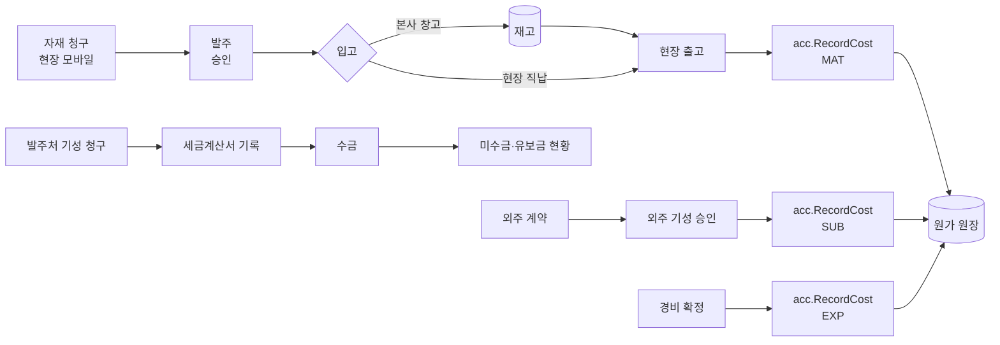

# 자재·외주·기성·수금 상세 기획 (v0.1) — Phase 2 "돈의 흐름"

작성일: 2026-11-10 · 상위 문서: `docs/01_ERP_기획설계서.md` 3.2~3.4절 · 선행: `docs/05_현장_원가_상세기획.md` · 모듈: `internal/mat`, `internal/prj`(외주·기성), `internal/acc`(매출·채권·매입)

이 문서는 자재 청구에서 출고까지, 외주 계약과 외주 기성, 경비, 발주처 기성 청구와 세금계산서·수금까지를 다룹니다. 원가 원장과 `RecordCost` 규칙은 05 문서 6장을 따릅니다.

**표기**: ✅ = 이미 정해진 것. ⏳ = 담당자 답 전까지 쓰는 기본값이고 괄호는 질문지 번호입니다. 질문지는 `question-2단계-자재외주기성.md`(2단계)이고, 05 문서의 현장1·현장2·1단계 질문지도 함께 씁니다.

---

## 1. 결정 목록

| 주제 | 결정 | 상태 |
|------|------|------|
| 자재 원가 귀속 | 창고 입고는 재고일 뿐 원가가 아니다. **출고할 때** 현장·공종 원가가 된다. 현장 직납은 입고 확인 때 곧바로 원가 | ✅ 01 설계서 3.3 / 직납 처리 ⏳ (2단계-3) |
| 재고 단가 | 이동평균 | ✅ 01 설계서 5장 / 다른 방식 ⏳ (2단계-4) |
| 외주 원가 | 외주 **기성 승인** 때 `SUB` 원가. 계약금액은 약정일 뿐 원가가 아니다 | 기성 승인 시점 ⏳ (2단계-10) |
| 유보금 | 외주에 주는 유보와 발주처에게서 받는 유보를 따로 관리 | ⏳ (2단계-9, 2단계-13) |
| 기성 청구 | 계약 내역 항목별 수량 × 단가, 이번·누계 | 내역 기준 ✅ 01 설계서 3.2 / 수량 기준 ⏳ (2단계-12) |
| 세금계산서 | 첫 단계는 ERP가 발행하지 않고 번호·일자·금액만 기록. 홈택스 연계는 2차 | ✅ 01 설계서 3.4 / 발행 기준 ⏳ (2단계-14) |
| 수금 | 입금 내역을 수동 입력 | ⏳ (2단계-15) |
| 발주·외주 승인 | 금액 구간별 승인자 표(`approval_rule`). 전자결재(WF) 전에는 승인 버튼 | ⏳ (2단계-5) |
| 매입 확정 | 입고(또는 외주 기성 승인) 때 확정, 세금계산서는 나중에 대사 | ⏳ (2단계-7) |
| 경비 | 증빙 첨부 필수, 확정 때 `EXP` 원가 | ⏳ (2단계-16) |
| 금액 | 원 단위 `int64`, 부가세 별도. 수량은 `numeric` | ✅ CLAUDE.md 규칙 3 |
| 자재·외주 승인 후 | 확정 줄은 고치지 않고 역분개 후 재기록 | ✅ 원장 추가만 (규칙 2) |

---

## 2. 업무 흐름



---

## 3. 자재 (`internal/mat`)

### 3.1 모델

| 테이블 | 핵심 컬럼 | 비고 |
|--------|----------|------|
| `item` | code, name, category, spec, unit, conv_unit, conv_rate | 배관 규격(15A~300A), 덕트 m²/kg 환산. `conv_rate`는 `numeric` |
| `warehouse` | id, name | 본사 창고. 개수는 ⏳ (2단계-2) |
| `material_request` / `_line` | project_id, wbs_id, item_id, qty, needed_on, status | 현장 모바일 청구 |
| `purchase_order` / `_line` | partner_id, project_id, status, ordered_on / item_id, qty, unit_price | 발주서 PDF |
| `goods_receipt` / `_line` | po_id, received_on, destination(`WAREHOUSE`/`PROJECT`), project_id / po_line_id, qty | 입고. 부분 입고 가능 |
| `stock` | warehouse_id, item_id, qty, value | `value`는 재고 금액(`bigint`)을 따로 유지 |
| `stock_tx` | tx_type(`IN`/`OUT`/`MOVE`/`RETURN`), item_id, qty, amount, project_id, wbs_id | 수불부. 추가만 |

### 3.2 규칙

1. **청구**: 청구 라인의 공종·원가요소 `MAT` 승인 예산 잔액을 보여 주고, 초과 시 경고만 합니다(저장은 막지 않음) ⏳ (2단계-6).
2. **발주**: 금액 구간에 따라 `approval_rule`로 승인자를 정합니다(5.4). 협력사 견적 비교는 선택 기능입니다.
3. **입고**: 도착지가 창고면 `stock`에 들어가고 원가는 없습니다. 도착지가 현장(직납)이면 재고를 거치지 않고 입고 확인 시 `MAT_DIRECT`로 원가를 기록합니다 ⏳ (2단계-3).
4. **출고**: 출고 금액은 이동평균 재고 금액 비례로 정하고(7.1), 확정 시 `MAT_ISSUE`로 기록합니다. 공종이 없으면 출고하지 못합니다.
5. **반납**: 반납은 출고 줄을 가리키는 역분개(`reverses_id`)를 기록하고 재고로 돌아옵니다.
6. **현장 간 이동**: 출발 현장 음수 줄과 도착 현장 양수 줄을 한 트랜잭션에서 기록합니다(`MAT_MOVE`).
7. **매입 확정**: 입고를 확인하면 매입(채무)이 확정되고, 세금계산서는 나중에 대조합니다 ⏳ (2단계-7).

감사 로그: 발주 승인, 입고 확인, 출고·반납·이동, 입고 취소.

---

## 4. 외주 (`internal/prj`)

### 4.1 모델

| 테이블 | 핵심 컬럼 | 비고 |
|--------|----------|------|
| `subcontract` | id, project_id, partner_id, signed_on, contract_amount, retention_permille, status(`DRAFT`/`ACTIVE`/`DONE`) | 총액 계약 + 공종별 금액 ⏳ (2단계-8) |
| `subcontract_item` | subcontract_id, wbs_id, amount | 공종별 약정 금액. 합 = 계약금액 |
| `subcontract_billing` | id, subcontract_id, seq, period_to, amount, cumulative, retention, pay_amount, status(`DRAFT`/`SUBMITTED`/`APPROVED`/`PAID`) | 외주 기성 회차 |
| `subcontract_billing_line` | billing_id, wbs_id, amount | 공종별 이번 기성액 |

### 4.2 규칙

- 외주 기성이 `APPROVED`되면 공종별 줄로 `SUB_BILLING` 원가를 기록합니다. 유보를 떼어도 **원가는 기성액 전액**이고, 지급액만 줄어듭니다.
- 누계 기성액은 계약금액을 넘지 못합니다. 넘어야 하면 계약 변경(증액)을 먼저 합니다.
- `APPROVED` 뒤 오류는 고치지 않고 다음 회차에 조정 줄을 넣습니다(03 문서 2.1과 같은 방식).
- 직영 일용직과 달리 외주 인력은 노무(LAB)가 아니라 외주비(SUB)입니다(GLOSSARY).
- 예상 → 확정 2단계(ADR-0001)를 외주에 쓸지는 외주 기성이 월 1회 정도라서 첫 단계에서는 **쓰지 않습니다**. 기성을 승인할 때 한 번에 확정합니다.

감사 로그: 계약 등록·변경, 기성 상신·승인, 지급 완료.

---

## 5. 경비와 승인 규칙

### 5.1 경비

`expense(project_id, wbs_id, category, occurred_on, amount, vat_amount, evidence_file_id, status)`. 증빙(영수증·카드전표 사진)이 없으면 확정하지 못합니다 ⏳ (2단계-16). 확정되면 `EXP` 원가를 `occurred_on` 기준으로 기록합니다. 카드 내역 엑셀 가져오기는 2차입니다.

### 5.2 지급 예정

외주 기성 지급액, 자재 매입 대금, 경비는 `payable`(지급 예정)로 모이고, 지급일과 지급 완료를 기록합니다. 은행 이체 파일은 03 문서 6장과 같은 양식 변환기를 씁니다. 협력사별 지급일 규칙은 첫 단계에서 입력만 합니다.

### 5.3 매입 대사

세금계산서(매입)를 입력하면 입고·외주 기성과 짝을 지어 금액 차이를 보여 줍니다. 자동 수집은 2차입니다.

### 5.4 승인 규칙 (`approval_rule`)

| 컬럼 | 설명 |
|------|------|
| doc_type | `PO` 발주, `SUBCONTRACT` 외주 계약, `SUB_BILLING` 외주 기성, `EXPENSE` 경비, `BUDGET` 실행예산 |
| min_amount, max_amount | 금액 구간 (이상 ~ 미만, 원) |
| approver_role | 승인 역할 |

기본값은 01 설계서 6장의 예시를 따라 **500만 원 미만 부서장 전결, 이상 대표**입니다 ⏳ (2단계-5). 규칙은 데이터이므로 코드에 금액을 넣지 않습니다. 전자결재(WF)가 생기면 이 표를 결재선 규칙으로 옮깁니다. 05 문서의 실행예산 승인도 같은 표를 씁니다.

---

## 6. 기성 청구·매출·수금

### 6.1 모델

| 테이블 | 핵심 컬럼 | 비고 |
|--------|----------|------|
| `contract_item` | contract_id, wbs_id, name, spec, unit, qty, unit_price, amount | 계약 내역. Phase 2에는 영업이 없으므로 엑셀로 올리거나 입력 (05 문서 4.2의 업로드 엔진 재사용). 설계변경은 변경 이력을 남기며 수량·단가를 바꿈 |
| `progress_billing` | project_id, seq, period_from, period_to, status(`DRAFT`/`SUBMITTED`/`ISSUED`/`CLOSED`), supply_amount, cumulative_amount, rate_permille, retention_amount | 기성 회차 |
| `progress_billing_line` | billing_id, contract_item_id, qty_this, qty_cum, unit_price, amount_this, amount_cum | 내역 항목별 이번·누계 |
| `invoice` | project_id, billing_id, number, issued_on, supply_amount, vat_amount | 매출 세금계산서 기록 |
| `receipt` | invoice_id, received_on, amount, note | 수금 |
| `retention_release` | project_id, released_on, amount | 발주처 유보금 해제 |

### 6.2 규칙

- **누계 수량은 계약 수량을 넘지 못합니다.** 넘어야 하면 설계변경(수량 변경)을 먼저 합니다. 이전 회차의 수량은 고치지 못합니다.
- 기성 회차는 `ISSUED`(세금계산서 발행 기록 완료) 뒤에는 고치지 않습니다. 오류는 다음 회차 조정 줄로 바로잡습니다.
- 기성 청구서 출력(엑셀·PDF)은 발주처 양식 샘플을 받은 뒤 템플릿으로 만듭니다 ⏳ (2단계-11). 처음에는 내역 항목별 수량·금액 누계 표가 기본입니다.
- 원도급 하도급과 건축주 직접 계약은 `contract.kind`로 구분하고, 양식과 유보금 규칙이 달라지면 그 차이를 이 문서에 추가합니다 ⏳ (2단계-1).
- 세금계산서는 유보금을 포함한 기성액 전체로 발행하는 것을 기본으로 둡니다 ⏳ (2단계-14).
- 수금은 은행 입금 내역을 보고 수동으로 입력합니다 ⏳ (2단계-15).
- 매출 금액은 원가 원장(`cost_entry`)에 쓰지 않습니다. 원가 원장은 원가 전용이고, 매출·채권은 `acc`의 `invoice`·`receipt`로 따로 관리합니다.

### 6.3 미수금과 유보금

```
미수금(현장)   = 발행한 세금계산서 합계(공급가액 + 부가세) − 수금 합계
유보금 잔액    = 누적 유보금 − 해제한 유보금
미수금 구간    = 발행일로부터 30일 이내 / 31~60일 / 61~90일 / 90일 초과
```

현장 종결은 미수금과 유보금 잔액이 0원일 때만 가능합니다(05 문서 3.2).

---

## 7. 계산 규칙 (순수 함수, 금액은 정수)

수량은 `numeric`(소수 3자리), 단가는 원 단위 `int64`, 비율은 천분율(‰) 정수입니다.

### 7.1 이동평균 재고

```
평균 단가(표시용) = 재고 금액 ÷ 재고 수량                -- numeric(18,4), 표시만
입고           : 재고 수량 += 입고 수량,  재고 금액 += 입고 금액
출고 금액       = floor( 재고 금액 × 출고 수량 ÷ 재고 수량 )
                 단, 출고 수량 = 재고 수량(전량 출고)이면 출고 금액 = 재고 금액 전부
출고            : 재고 수량 −= 출고 수량,  재고 금액 −= 출고 금액
```

재고 금액을 `bigint`로 따로 들고 있으면 평균 단가를 반올림해서 쌓이는 오차가 없습니다. 전량 출고에서 재고 금액을 남김없이 가져가므로 재고 수량 0에 재고 금액이 남는 일이 없습니다. 재고보다 많은 출고는 거부합니다.

### 7.2 기성

```
내역 금액(이번)   = floor( 이번 수량 × 단가 )              -- 원 미만 절사
이번 기성액       = Σ 내역 금액(이번)
유보금           = floor( 이번 기성액 × 유보율(‰) ÷ 1000 )
부가세           = floor( 공급가액 ÷ 10 )                  -- 10%
기성률(‰)        = 누계 기성액 × 1000 ÷ 현재 계약금액       -- 표시용
수령 예정액       = 공급가액 + 부가세 − 유보금
외주 지급액       = 외주 기성액 − 외주 유보금
```

원 미만 처리는 절사가 기본이고 계약서 관행과 다르면 바꿉니다 ⏳ (2단계-12). 누계 기성액은 마지막 회차의 `amount_cum` 합이고, 현재 계약금액을 넘지 못합니다.

### 7.3 필수 경계값 테스트

| 경우 | 기대 |
|------|------|
| 재고 10, 금액 1,000,000. 3 출고 | 출고 금액 300,000 |
| 재고 3, 금액 1,000. 1 출고 → 1 출고 → 1 출고 | 333 → 333 → 334 (마지막에 남은 금액 전부), 재고 금액 0 |
| 재고보다 많은 수량 출고 | 거부, 재고 변화 없음 |
| 입고 단가가 서로 다른 두 번 입고 후 출고 | 출고 금액은 평균 단가 기준, 총액 보존 |
| 반납 | 출고 줄의 역분개, 재고 수량·금액이 원래대로 |
| 현장 간 이동 | 두 현장 합계 0원 변동 |
| 기성 누계 수량 = 계약 수량 / 초과 | 허용 / 거부 |
| 이번 수량 0.5, 단가 3원 | 내역 금액 1원 (절사) |
| 유보율 5%(50‰), 이번 기성액 999원 | 유보금 49원 (절사) |
| 공급가액 9원 | 부가세 0원 |
| 외주 누계 기성액 = 계약금액 / 1원 초과 | 허용 / 거부 |
| 승인된 기성 수정 시도 | 거부, 다음 회차 조정 줄만 허용 |
| 발행 금액 이상으로 수금 | 거부 또는 경고 (선수금은 별도 처리) |
| 미수금 구간 경계 (발행 후 30일 / 31일) | 30일 이내 / 31~60일 |
| 유보금 해제액 > 유보금 잔액 | 거부 |

---

## 8. 화면

| 화면 | 사용자 | 핵심 |
|------|-------|------|
| 자재 청구 (모바일) | 현장소장 | 품목 검색, 공종 선택, 예산 잔액 표시 |
| 발주·입고 | 구매·창고 | 발주서 출력, 부분 입고, 직납 입고 |
| 재고·출고 | 창고 | 현장 출고, 반납, 이동, 수불부 |
| 외주 계약·기성 | 공무 | 계약 잔액, 회차별 기성, 유보, 지급 예정 |
| 경비 입력 | 현장소장·경리 | 영수증 사진, 공종 선택, 확정 |
| 기성 청구 | 공무·경리 | 내역 항목별 이번·누계, 청구서 출력 |
| 세금계산서·수금 | 경리 | 발행 기록, 입금 입력, 미수금 구간 |
| 현장 손익 (05 문서 8장 확장) | 공무·임원·대표 | 예산·원가·매출·미수금·유보금 한 화면 |

---

## 9. 권한과 감사

- 현장 데이터는 모두 `auth.ProjectScope`를 거칩니다(규칙 5). 재고·구매는 현장이 아닌 창고 단위 권한이 필요하므로 구매·창고 역할을 따로 둡니다.
- 협력사별 단가·계약 금액은 구매·공무·임원만 봅니다. 현장소장은 자기 현장의 수량 중심 화면을 봅니다.
- 감사 로그(규칙 6): 발주·외주 승인, 입출고 취소, 기성 상신·승인·조정, 세금계산서 기록, 수금, 유보금 해제.

---

## 10. 확인이 필요한 사항

17개 질문은 `question-2단계-자재외주기성.md`에 있습니다. 상태는 질문지 안의 `상태:` 줄이 기준입니다. 받는 사람은 대표, 공무, 구매·창고, 경리입니다.

---

## 11. 구현 순서 (티켓 단위)

| # | 작업 | 선행 | 완료 기준 |
|---|------|------|----------|
| 1 | 이동평균 재고·기성·유보금·부가세 계산 (순수 함수) | — | 7.3 경계값 통과 |
| 2 | 품목·창고 기준정보, 단위 환산 | Phase 0 | 규격·단위 환산 테스트 |
| 3 | 자재 청구 → 발주 → 입고 → 출고 + `MAT_ISSUE` | 2, 05 문서 티켓 2 | 출고 시 원장에 `MAT` 줄 |
| 4 | 승인 규칙(`approval_rule`) | — | 금액 구간별 승인자 결정 테스트 |
| 5 | 외주 계약·기성·유보 + `SUB_BILLING` | 4, 05 문서 티켓 2 | 승인 시 원장에 `SUB`, 지급액 = 기성액 − 유보 |
| 6 | 경비 입력·증빙·`EXP` | 4 | 증빙 없이 확정 불가 |
| 7 | 계약 내역·기성 청구·청구서 출력 | 05 문서 티켓 4 | 누계 수량 검증, 엑셀 출력 |
| 8 | 세금계산서 기록·수금·미수금·유보금 | 7 | 미수금·유보금 잔액 리포트 |
| 9 | 현장 손익 화면 확장 | 3, 5, 6, 8 | 예산·원가·매출·미수금 한 화면 |

1번은 DB 없이 `/tdd`로 시작할 수 있습니다.
