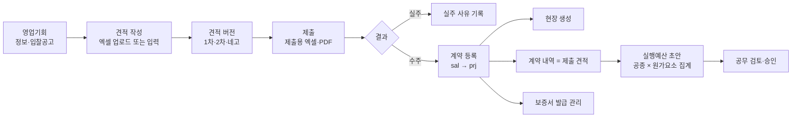

# 영업·견적·수주 상세 기획 (v0.1) — Phase 3 "영업"

작성일: 2026-11-10 · 상위 문서: `docs/01_ERP_기획설계서.md` 3.1절 · 선행: `docs/05_현장_원가_상세기획.md`, `docs/06_자재_외주_기성_상세기획.md` · 모듈: `internal/sal`

이 문서는 영업기회, 견적(내역서) 작성과 버전, 일위대가·단가 DB, 수주(계약 등록), 설계변경, 보증서를 다룹니다. 핵심 목표는 **견적 내역이 수주 뒤 계약 내역과 실행예산으로 다시 입력하지 않고 이어지는 것**입니다.

**표기**: ✅ = 이미 정해진 것. ⏳ = 담당자 답 전까지 쓰는 기본값이고 괄호는 질문지 번호입니다. 질문지는 `question-3단계-영업견적.md`(3단계)입니다.

---

## 1. 결정 목록

| 주제 | 결정 | 상태 |
|------|------|------|
| 순서 | 영업(견적)은 현장·원가보다 **나중**. 그동안 견적은 지금 쓰는 엑셀을 업로드해서 대체 | ✅ 01 설계서 8장 |
| 엑셀 | 발주처 양식 내역서 업로드, 제출용 엑셀 출력이 가장 중요한 기능 | ✅ 01 설계서 3.1 |
| 현장 생성 | 수주(계약 등록)가 현장을 만든다. 05 문서의 계약 등록 기능을 `sal`이 그대로 호출 | ✅ 05 문서 3.3 |
| 견적 버전 | 1차/2차/네고, 버전 간 증감 비교. 제출한 버전은 고치지 않음 | ⏳ (3단계-3) |
| 견적 금액 구조 | 품목별 재료비·노무비·경비 단가 × 수량 + 일반관리비·이윤 | 구조 ✅ 01 설계서 5장 / 비율 ⏳ (3단계-4) |
| 일위대가 | 표준품셈 기반 + 자사 실적 단가 + 최근 매입단가를 **참조**하되 자동 확정하지 않음 | ⏳ (3단계-5) |
| 실행예산 연결 | 수주 때 견적 내역을 공종 × 원가요소로 집계해 실행예산 초안(`DRAFT`)을 만든다. 승인은 공무 | ⏳ (3단계-7) |
| 보증서 | 계약·선급금·하자보수 보증 발급·만료 알림 | ⏳ (3단계-9) |
| 실주 | 실주 사유를 기록 | ⏳ (3단계-10) |
| 영업 담당자 | 영업기회 1건 = 담당자 1명(복수 지정 불가) | ⏳ (3단계-11) |
| 금액 | 원 단위 `int64`, 부가세 별도 | ✅ CLAUDE.md 규칙 3 |

---

## 2. 업무 흐름



---

## 3. 영업기회

### 3.1 모델

| 테이블 | 핵심 컬럼 | 비고 |
|--------|----------|------|
| `opportunity` | id, name, client_id, expected_amount, bid_on, stage, owner_id, region, note | 발주처는 거래처(`partner`)에서 선택 |
| `opportunity_stage_log` | opportunity_id, stage, changed_on, changed_by | **추가만**. 단계 이력 |

### 3.2 단계

`INFO`(정보) → `ESTIMATING`(견적) → `BID`(입찰·제출) → `WON`(수주) 또는 `LOST`(실주) 또는 `DROPPED`(포기). 단계 이름은 01 설계서 3.1을 따르고, 회사가 쓰는 단계가 다르면 바꿉니다 ⏳ (3단계-1). `WON`은 계약이 등록될 때만 됩니다. `LOST`와 `DROPPED`에는 사유가 필요합니다 ⏳ (3단계-10).

---

## 4. 견적

### 4.1 모델

| 테이블 | 핵심 컬럼 | 비고 |
|--------|----------|------|
| `estimate` | id, opportunity_id, version, status(`DRAFT`/`SUBMITTED`/`SUPERSEDED`), submitted_on, overhead_permille, profit_permille, rounding_unit, note | 기회당 버전이 여러 개 |
| `estimate_item` | estimate_id, wbs_id, parent_id, item_id, name, spec, unit, qty, mat_price, lab_price, exp_price, source_unit_price_id | 내역 한 줄. 단가는 원 단위 `bigint`, 수량 `numeric(18,3)`. 그룹(소계) 줄은 `parent_id` 트리 |
| `unit_price` | id, kind(`STANDARD`/`ACTUAL`/`PURCHASE`), item_id, mat, lab, exp, effective_from, source, note | 단가 DB. 적용일 이력 |
| `composite_price` (일위대가) | id, name, unit, mat, lab, exp / `composite_price_line`: composite_id, item_id 또는 trade_id, qty | 품셈 구성. 계산 결과를 견적 줄에 복사할 때 `source_unit_price_id`로 출처를 남김 |

### 4.2 규칙

1. **엑셀 업로드**: 05 문서 4.2의 열 매핑·검증 엔진을 재사용합니다. 발주처 양식(공종, 품명, 규격, 단위, 수량, 단가 열)을 한 번 매핑해 저장해 두고 다음 건에서 씁니다.
2. **버전**: 제출한 버전(`SUBMITTED`)은 고치지 않습니다. 네고는 새 버전을 복사해서 시작하고, 이전 버전은 `SUPERSEDED`입니다 ⏳ (3단계-3). 두 버전을 줄 단위로 비교해 증감을 보여 줍니다.
3. **금액 합계**: 계산식은 7장에 있습니다. 단가에는 재료비·노무비·경비를 따로 두어 실행예산의 원가요소와 그대로 이어집니다(01 설계서 4.2).
4. **제출용 출력**: 발주처가 정한 양식이 있으면 그 양식으로, 없으면 회사 기본 양식으로 엑셀·PDF를 만듭니다 ⏳ (3단계-2). 양식 샘플은 `docs/references/sal/`에 둡니다.
5. **단가 참조**: 품목을 고르면 최근 매입단가와 자사 실적 단가를 옆에 보여 주고, 사용자가 선택한 값만 견적 줄에 들어갑니다. 자동으로 채우지 않습니다 ⏳ (3단계-5).

감사 로그: 견적 제출, 버전 생성, 일위대가·표준 단가 변경.

---

## 5. 수주와 설계변경

### 5.1 수주

영업기회에서 "수주" 처리를 하면 다음이 한 트랜잭션으로 일어납니다.

1. `sal`이 `prj`의 계약 등록 서비스(`prj.RegisterContract`)를 호출해 계약과 현장을 만듭니다(05 문서 3.3). `contract.kind`(원도급 하도급 / 건축주 직접)와 계약 조건(선급금, 지체상금률, 유보율, 하자보수 기간)을 입력합니다.
2. **제출한 견적 버전의 내역**이 계약 내역(`contract_item`, 06 문서 6.1)으로 복사됩니다. 협상으로 최종 금액이 견적과 다르면 마지막 버전의 금액을 계약 금액에 맞춰 조정하고, 조정 내용을 남깁니다 ⏳ (3단계-6).
3. 내역을 공종 × 원가요소로 집계해 **실행예산 초안**(`DRAFT`)을 만듭니다. 재료비·노무비·경비는 견적 단가에서 그대로 나오고, 외주비는 견적에 없으므로 0에서 시작해 공무가 채웁니다 ⏳ (3단계-7). 승인은 05 문서 4.2의 절차를 따릅니다.
4. 영업기회는 `WON`이 되고, 견적 버전은 계약에 연결되어 고쳐지지 않습니다.

### 5.2 설계변경

계약금액이 바뀌면 `contract_change`(05 문서 3.3)에 증감 이력을 쌓고, 변경 내역서(`contract_item`의 수량·단가 변경)를 연결합니다. 변경 계약 후 실행예산은 자동으로 바뀌지 않고, 공무가 새 버전을 만듭니다(05 문서). 증감 내역서는 견적 버전 비교와 같은 비교 기능을 씁니다.

---

## 6. 보증서

`guarantee(contract_id, kind[계약/선급금/하자보수], issuer, number, amount, issued_on, expires_on, status)`. 만료 30일 전과 7일 전에 알림을 보냅니다(알림 방식은 첫 단계에서 화면 표시와 메일까지) ⏳ (3단계-9). 하자보수 보증은 `DEFECT` 상태의 현장과 연결되어, 보증이 만료되기 전에 종결하지 못하도록 경고를 보여 줍니다.

---

## 7. 계산 규칙 (순수 함수, 금액은 정수)

수량은 `numeric(18,3)`, 단가는 원 단위 `int64`, 비율은 천분율(‰)입니다.

```
내역 금액(원가요소별) = floor( 수량 × 단가 )              -- 재료비·노무비·경비를 각각 계산 후 절사
줄 합계              = 재료비 금액 + 노무비 금액 + 경비 금액
직접공사비           = Σ 줄 합계
일반관리비           = floor( 직접공사비 × 일반관리비율(‰) ÷ 1000 )
이윤                = floor( (노무비 합 + 경비 합 + 일반관리비) × 이윤율(‰) ÷ 1000 )   ⏳ (3단계-4)
견적 공급가액        = 직접공사비 + 일반관리비 + 이윤  → 절사 단위(rounding_unit)로 절사
부가세              = floor( 견적 공급가액 ÷ 10 )
```

- 일반관리비율·이윤율과 이윤의 기준(노무비·경비·일반관리비의 합 등)은 회사 관행을 확인하기 전까지 위를 기본값으로 둡니다. 공공 공사의 법정 요율표는 쓰지 않고, 회사가 견적마다 입력합니다 ⏳ (3단계-4).
- 절사 단위(`rounding_unit`)는 원, 십원, 백원 중에서 견적마다 고릅니다. 기본값은 1,000원입니다 ⏳ (3단계-4).
- 실행예산 초안 = Σ(공종, 원가요소별 내역 금액). 일반관리비와 이윤은 원가가 아니라 **마진**이므로 실행예산에 넣지 않습니다. 따라서 `실행예산 합계 ≤ 계약 공급가액`이고 차이가 예상 이익의 상한입니다.
- 버전 비교: 같은 `(wbs, item, spec)` 줄끼리 짝지어 수량·단가·금액 증감을 계산합니다. 짝이 없는 줄은 추가/삭제로 표시합니다.

### 7.1 필수 경계값 테스트

| 경우 | 기대 |
|------|------|
| 수량 0.333 × 단가 1,000원 | 333원 (절사) |
| 재료·노무·경비 각각 소수 발생 | 각각 절사한 뒤 합산 (합친 뒤 절사하지 않음) |
| 일반관리비율 0‰ / 이윤율 0‰ | 일반관리비·이윤 0원 |
| 직접공사비 + 일반관리비 + 이윤이 절사 단위 미만 | 0원이 아닌 한 절사 후 값 그대로 확인 |
| 절사 단위 1,000원, 공급가액 1,234,567원 | 1,234,000원 |
| 공급가액 9원 | 부가세 0원 |
| 같은 견적을 복사해 네고 버전 생성 | 모든 줄 동일, 이전 버전 `SUPERSEDED` |
| 제출한 버전 수정 시도 | 거부 |
| 버전 비교: 수량만 변경 / 줄 추가 / 줄 삭제 | 증감·추가·삭제로 각각 표시 |
| 수주 시 외주비 | 실행예산 초안에서 0 |
| 실행예산 초안 합계 > 계약 공급가액 | 허용하되 경고 |
| 엑셀 업로드: 공종 없음, 음수 수량, 단위 불일치 | 행 번호와 함께 거부 |

---

## 8. 화면

| 화면 | 사용자 | 핵심 |
|------|-------|------|
| 영업기회 목록·칸반 | 영업·대표 | 단계별 건수·예정금액, 입찰일 임박 강조 |
| 견적 편집 | 견적 | 대량 그리드(엑셀식 편집), 트리 소계, 단가 참조 패널 |
| 견적 버전 비교 | 견적·대표 | 두 버전 나란히, 증감 강조 |
| 제출 출력 | 견적 | 발주처 양식/기본 양식 엑셀·PDF |
| 수주 처리 | 영업·공무 | 계약 조건 입력, 현장 생성, 실행예산 초안 미리보기 |
| 단가 DB | 견적 | 표준·실적·매입단가 검색, 일위대가 구성 |
| 보증서 | 경리 | 만료 임박순, 알림 |
| 영업 현황 | 대표 | 수주율, 실주 사유 분포, 수주 잔고 |

---

## 9. 권한과 감사

- 견적 단가와 마진(일반관리비·이윤)은 견적·영업·임원만 봅니다. 현장소장에게는 계약 내역의 수량만 보여 줍니다(01 설계서 6장의 "계약 단가는 견적·임원만").
- 영업기회는 `auth.ProjectScope` 대상이 아닙니다(현장이 아님). 대신 담당자와 임원이 봅니다. 수주 뒤 생긴 현장부터 범위 필터가 적용됩니다.
- 감사 로그(규칙 6): 견적 제출, 수주 처리, 설계변경, 단가 변경, 보증서 변경.

---

## 10. 확인이 필요한 사항

12개 질문은 `question-3단계-영업견적.md`에 있습니다. 상태는 질문지 안의 `상태:` 줄이 기준입니다. 받는 사람은 대표, 견적, 영업, 경리입니다. 견적서 엑셀 양식 샘플은 `docs/references/sal/`에 둡니다.

---

## 11. 구현 순서 (티켓 단위)

| # | 작업 | 선행 | 완료 기준 |
|---|------|------|----------|
| 1 | 견적 금액 계산·버전 비교 (순수 함수) | — | 7.1 경계값 통과 |
| 2 | 영업기회 + 단계 이력 | Phase 0 | 단계 전이 테스트 |
| 3 | 견적 헤더·내역 + 엑셀 업로드 (05 문서 업로드 엔진 재사용) | 1, 2, 05 문서 티켓 5 | 발주처 양식 업로드 → 검증 → 저장 |
| 4 | 견적 버전·제출 고정·출력(엑셀) | 3 | 제출본 수정 거부, 제출용 엑셀 |
| 5 | 단가 DB·일위대가 | 3 | 출처가 남는 단가 참조 |
| 6 | 수주 처리: 계약·현장·계약 내역·실행예산 초안 | 4, 05 문서 티켓 4·5, 06 문서 티켓 7 | 견적 합계 = 계약 내역 합계, 초안 합계 ≤ 공급가액 |
| 7 | 설계변경(변경 내역서) | 6 | 변경 이력, 버전 비교 재사용 |
| 8 | 보증서·만료 알림 | 6 | 30일/7일 전 알림 |
| 9 | 영업 현황 | 2, 6 | 수주율·실주 사유 |

1번은 DB 없이 `/tdd`로 시작할 수 있습니다.
